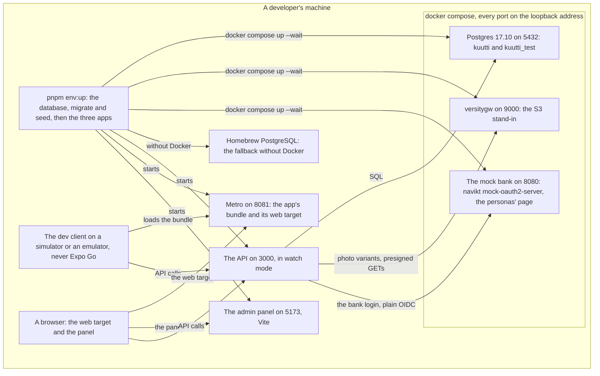
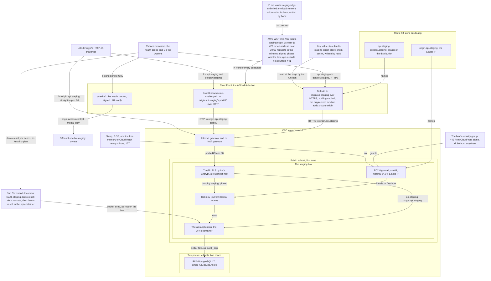
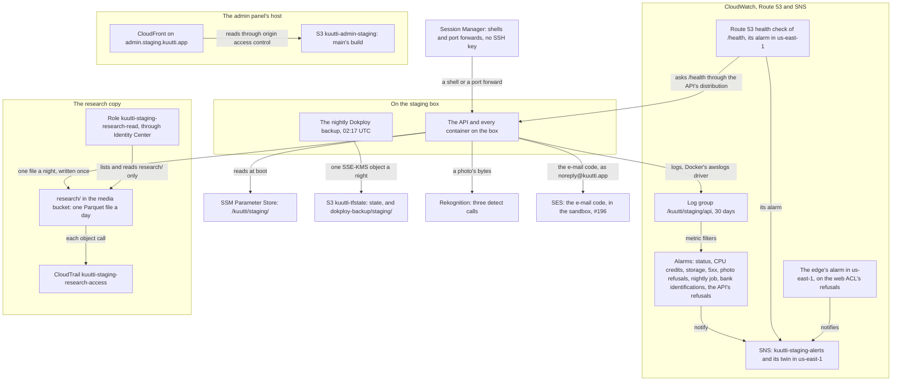
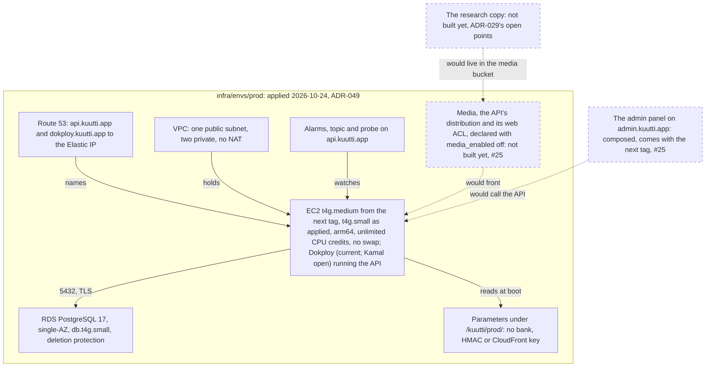
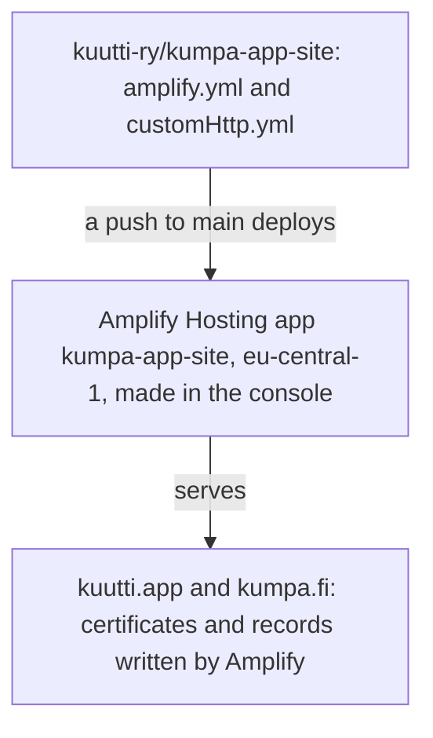

# Deployment

<!-- draws
docker-compose.yml
scripts/dev-env.ts
infra/envs/
infra/modules/
infra/bootstrap/
infra/scripts/dokploy-setup.sh
infra/scripts/db-app-role.sh
.github/workflows/demo-reset.yml
-->

Where each part of Kuutti runs, environment by environment: a developer's machine, staging and the services around its box, production as applied on 2026-10-24 (ADR-049), and the website. It is for a contributor who wants to know what a change will land on, and for a reviewer of `infra/`. Everything here is read from `infra/`, the workflows and the compose file on `main`; what is planned is dashed and names its issue. The deploy tool is drawn as it runs today, Dokploy, while Dokploy versus Kamal stays open. The view draws ADR-001, ADR-005, ADR-008, ADR-014, ADR-018, ADR-025, ADR-029, ADR-043, ADR-046, ADR-048, ADR-049, ADR-054, ADR-066, ADR-067 and ADR-070.

## Part 1: a developer's machine

### Steps

1. `pnpm env:up` starts the whole local environment. It brings up the database with `docker compose up -d --wait` when Docker is there, and Homebrew PostgreSQL otherwise. It frees a port held by a stale copy of one of our own processes and stops at anything else, migrates and seeds the database for development, then starts the API, Metro and the panel and waits until each answers. `pnpm env:down` stops the compose database; it leaves a shared Homebrew PostgreSQL running. A database already holding the compose port is named and left alone.
2. Postgres 17.10 in compose, published on port 5432 of the loopback address only, with the databases `kuutti` and `kuutti_test` (the second made once, when the volume is new).
3. versitygw, the S3 stand-in, on port 9000 of the loopback address, with the media bucket as a directory. Locally the API presigns its own GETs on it, where a deployed API signs CloudFront URLs.
4. The mock bank, `navikt/mock-oauth2-server`, on port 8080 of the loopback address, with the issuer `/ftn`. Its login page is ours: a button for each persona and a form for arbitrary claims shaped like Telia's (ADR-014).
5. Homebrew PostgreSQL: the fallback when docker compose is not available. The S3 stand-in and the mock bank stay down then.
6. The API on port 3000, run by Node in watch mode from source. In development it reads no parameter store, sends no mail (the message, code included, is written to its log) and no push (the kind of each is written to its log), and with no `MODERATION` set it never calls Rekognition.
7. Metro on port 8081: the app's bundle for the dev client and the web target of the same app.
8. The admin panel on port 5173, served by Vite. With no `VITE_API_URL` it talks to `http://localhost:3000`, and the API's development allowlist admits it and the web target.
9. The dev client: a development build of the app on an iOS simulator or an Android emulator, never Expo Go. The Maestro flows drive it against this same environment (ADR-020).
10. A browser: the app's web target, which runs against seed data and the mock bank and is not a product surface, and the admin panel.

## Part 2: staging, its network and its box

### Steps

11. Who reaches staging from outside: phones and browsers, Route 53's health checkers, and GitHub Actions, which deploys through Dokploy's API and, by hand, sends the demo's reset (step 64).
12. Route 53: `api.staging` and `dokploy.staging` are aliases (A and AAAA) of the API's distribution, since staging's `media_enabled` is on. Dokploy's moved there from the Elastic IP with #198, the record changed in place.
13. Route 53: `origin.api.staging` is an A record to the box's Elastic IP, with a TTL of five minutes. With media off, `api.staging` and `dokploy.staging` would be such records instead, and `origin.api.staging` would not exist.
14. CloudFront's default behaviour: every method, nothing cached, every viewer header and cookie forwarded with the ones CloudFront adds (the viewer's address, the WebSocket's headers), sent over HTTPS (TLS 1.2) to `origin.api.staging`, where Traefik routes the request by its forwarded Host. TLS for viewers ends here, with an ACM certificate from us-east-1 that names the distribution's two aliases. A viewer-request CloudFront Function, `kuutti-staging-origin-proof`, removes any `x-kuutti-origin` the viewer sent and sets the store's value (step 67): the proof by which the API tells Kuutti's distribution from anybody's (ADR-066). Price class 100 (Europe and North America), HTTP/2 and HTTP/3, IPv6. Nothing may be cached on it: the API and Dokploy share it, and a cache key without the Host would hand one host's answer to another.
15. CloudFront's `/media/*` behaviour: GET and HEAD only, HTTPS only, and only with a URL signed by a key of the trusted key group. A variant is cached once however many URLs were signed for it: the query string is not part of the key.
16. The media bucket `kuutti-media-staging-<account>`: private, public access blocked, SSE-S3, versioning off so an erased photo is gone. Its policy admits only the distribution to `media/`; the instance role also writes, reads and removes variants there. Unfinished uploads go after a day; `research/` is part 3.
17. The VPC: one /16 for the environment, an internet gateway for the public subnet's one route out, and no NAT gateway: the box is public and RDS makes no outbound connection, so the private subnets have only the local route. Its security group admits 443 from CloudFront's origin-facing prefix list alone (step 24), 80 from anywhere (for the ACME challenge and the redirect) and port 22 only from a list that is empty by default; Session Manager is the way in.
18. The box: EC2 `t4g.small`, arm64, Ubuntu 24.04 from Canonical's current image at the time it was built, an Elastic IP, IMDSv2 only with a hop limit of 2 so that containers reach the instance role, a 30 GB encrypted gp3 root volume, and standard CPU credits (it slows down rather than costs more). Its role is `kuutti-api-staging`, under the bootstrap's permissions boundary. A newer image or an edited first-boot script never replaces it; a rebuild is an explicit `-replace`.
19. Traefik, installed with Dokploy: it terminates TLS for the hosts the box serves, and routes by host. `dokploy.staging`, `api.staging` and `origin.api.staging` each have a Let's Encrypt certificate of their own, by HTTP-01; for the two behind the distribution the challenge comes through it (step 65). Two routers with a high priority, written by `dokploy-setup.sh` once Dokploy has its owner, pin `dokploy.staging` to Dokploy and `api.staging` to the API, so a token that may add domains cannot take either. Before that, first boot leaves Traefik no route to Dokploy at all, since the first visitor of a Dokploy without an owner becomes it (ADR-048). `origin.api.staging` is a second domain of the API's application, given by hand at the media cutover, so that CloudFront can reach the box by that name.
20. Dokploy (current; Kamal open): version v0.30.6, from an installer vendored in `infra/modules/compute` and checked by its hash at first boot. It runs a one-node Docker Swarm with its own Postgres and Traefik. Port 3000 is never opened. Traefik serves Dokploy's UI and its API, which CI calls, at `dokploy.staging.kuutti.app` through the distribution (#198), reachable by anyone behind Dokploy's own login with two-factor authentication, and no longer on the box's own address (step 24); the Session Manager port forward is how the admin account was first made. Its own configuration is outside code, the one manual island of ADR-001, backed up every night (part 3). Docker logs every container to CloudWatch.
21. The `api` application: the API's image from GHCR, with the environment `NODE_ENV=production`, `APP_ENV=staging` and `PORT=3000`; everything else comes from the parameter store through the instance role. Staging holds no real person: Telia's test persons and the synthetic population only (ADR-018).
23. RDS PostgreSQL 17 (the major pinned, minor versions applied automatically), single-AZ, `db.t4g.micro`: gp3 storage from 20 GB growing to 100, encrypted, 35 days of point-in-time recovery, TLS forced, Extended Support declined, not publicly reachable, no deletion protection on staging. Its subnet group spans the two private subnets in the region's first two zones, as RDS requires even for one instance. Its security group admits 5432 from the box's security group alone. The master password is held by AWS; the API connects as `kuutti_app`.
24. Ingress from CloudFront alone (#198): `cloudfront_only_ingress` replaces the open 443 rule with CloudFront's origin-facing prefix list, once Dokploy's control plane was behind the distribution too (ADR-005 §7). A connection to the box's 443 from anywhere but a CloudFront server gets no answer; port 80 stays open to anyone (step 66). The list is every CloudFront distribution's, though, not this one's alone, and anybody's distribution may send `CloudFront-Viewer-Address` with a value of its own. So the rate limiter's `trusted-proxy`, `cloudfront` since 2026-11-06, believes that address only from a request carrying the proof of Kuutti's distribution (step 67, ADR-066); any other request has no address and shares the one bucket of no address. A precondition in the composition refuses `cloudfront` without the switch, and the API refuses it without the secret. The Route 53 probe asks for `"originProof":"valid"`, so a store and a parameter that disagree page someone.
25. Swap and the free memory (#77, ADR-046): a 2 GB `/swapfile` with `vm.swappiness = 10`, and `MemAvailable` pushed every minute to `Kuutti/staging/box` by a cron line, which the alarm `kuutti-staging-memory-low` reads (part 3). First boot runs the script; the running box got it from the Run Command document `kuutti-staging-headroom` on 2026-10-24. Dokploy runs without a memory limit (ADR-046 §2).
64. The Run Command document `kuutti-staging-demo-reset` (#613, ADR-018 §8): `demo-reset.yml`, from `main` every night at 02:17 in Helsinki and by hand ([Delivery](delivery.md), part 5), sends it as `kuutti-ci-plan`, which the bootstrap lets send exactly this document to exactly this box. It takes no parameter. On the box, as root, it finds the task of the `api` application and runs `node dist/demo-assets.js` and then `node dist/demo-reset.js --env staging` in the container, both reading staging's parameters through the instance role as the API does; the reset's exit code is the command's, 2 naming the personas it spared (a staff role or a line in the audit log, ADR-014 §12), 3 meaning no `api` container runs. Declared by staging alone (`demo_reset = true` in `envs/staging`); production has no such document, and its container refuses the command anyway (ADR-018 §3). The headroom document of step 25 is the box's third, sent by the maintainer alone.
65. CloudFront's `/.well-known/acme-challenge/*` behaviour (#198): GET and HEAD, plain HTTP allowed, nothing cached, and of what the viewer sent only the Host forwarded (no cookie, other header or query string; CloudFront adds the requester's address), to `origin.api.staging` on port 80 over HTTP. Under the default behaviour the challenge for a name behind the distribution would be redirected to HTTPS and answered by the API with a 404, so Traefik's certificates for `api.staging` and `dokploy.staging` could not renew. On port 80 Traefik's challenge router outranks every other router and answers only a token it is waiting for. The renewals matter because CloudFront accepts the box's certificate when it names either the origin or the forwarded Host, and AWS does not say which of the two it asks the box for.
66. Let's Encrypt: its HTTP-01 challenge for `api.staging` and `dokploy.staging` comes through the distribution (step 65), the one for `origin.api.staging` straight to the box's port 80, which stays open to anyone for it and for the redirect to HTTPS.
67. The key value store `kuutti-staging-origin-proof` (#198, ADR-066): its one key, `origin-secret`, is the value the function of step 14 sends as `x-kuutti-origin`, and the API compares it with its own copy, the SecureString `origin-secret` of step 29. Both are written by hand, never by OpenTofu, so the value is in no state; CI's plan role may not read the store (`ci_plan_deny_data`), the maintainer's bootstrap applies that. In `cloudfront` mode a request without the proof has no address; in `traefik` mode the proof changes nothing the limiter does. `/health` says what the box sees: `trustedProxy` and `originProof` (`valid`, `missing`, `wrong`, `unset`). The store is the environment's, outside `modules/media`, so production's exists before its cutover.
68. The web ACL `kuutti-staging-edge` (#41, ADR-067), in us-east-1 as CloudFront's are, on the distribution: one rate-based rule refuses an address past 2,000 requests in any five minutes with 429, `Retry-After: 300` and the API's own envelope, `rate_limited` with `"requestId":"edge"`, until its count is under the limit again. The address is the one CloudFront took the connection from. It counts every request the distribution sends to the box, whatever the host, but two kinds, named in `modules/media/edge.json`: a signed photo, which never reaches the box, by the exact shape the API signs, since CloudFront picks a behaviour on the normalised path and sends the raw one on; and the two sign-in starts, which the API refuses with its own redirect (ADR-026 §4). A request through somebody else's distribution never meets it (step 24). It keeps metrics only: no WAF log and no sampled request, since both keep addresses, and CI's plan role may not read the list of addresses it is refusing. Its alarm is part 3's. The API's own windows come after it (ADR-026).
69. The IP set `kuutti-staging-edge-unlimited`: addresses the rule does not count, empty but for the load smoke's runner during a run's hour, written and removed by hand with the CLI ([capacity.md](../runbooks/capacity.md), Before a run, step 8). OpenTofu declares it and ignores what is in it, so no address is in the repository. IPv4 only; a run goes over IPv4.

## Part 3: staging, the services around the box

### Steps

26. The API and every other container on the box: Docker's default log driver is `awslogs`, set before Dokploy's installer starts a single container.
27. The nightly backup: a cron job at 02:17 UTC packs `/etc/dokploy` (Traefik's configuration and certificates, the applications) with a dump of Dokploy's database and puts it, encrypted with SSE-KMS, under `dokploy-backup/staging/` of the state bucket. The box may write its own prefix, never read, list or delete it, since every container on the box holds its role; a rebuild fetches the backup through a link the maintainer presigns (ADR-054). The plan role, denied `kms:Decrypt`, cannot read it.
28. Session Manager: the way onto the box, as `ssm-user`, and the port forward to Dokploy's UI. Staging declares the account's session preferences: every session is streamed to the log group `/kuutti/ssm-sessions`, kept 90 days, so nothing secret is ever printed in one.
29. SSM Parameter Store, `/kuutti/staging/`: the non-secret parameters `infra/envs/staging` writes (`app-env`, `log-level`, the database's `db-*`, `moderation`, `mail`, `push`, `admin-app-url`, `cors-allowed-origins`, `trusted-proxy`, the media's three, and the bank's four: Telia's pre-production issuer, its client id, the callback and the level), and the secrets made by hand, never resources (the hetu HMAC key, the two Telia keys, the CloudFront signing key, the database password, the origin secret of ADR-066, and Expo's access token once EAS's enhanced push security is on, #102), with Sentry's public DSN, also put by hand. The box's role reads this prefix only and is denied every other, `/kuutti/prod/` included.
30. CloudWatch Logs: `/kuutti/staging/api`, one stream per container name, kept 30 days, with five saved Logs Insights queries (errors by route, latency by route, boot, bank identifications by platform, refusals by route).
31. The alarms: `kuutti-staging-instance-status-check-failed`, `-instance-cpu-credits-low`, `-db-cpu-credits-low`, `-db-free-storage-low`, `-api-5xx`, `-photo-budget-refusals`, `-nightly-job-failed`, `-bank-identifications`, `-api-refusals` and `-memory-low`: five on metric filters over the API's log, the last on the box's own push to `Kuutti/staging/box`. `-api-refusals` counts the API's 429s and its `sign-in refused` lines (#41, ADR-026 §7). The edge's, `kuutti-staging-edge-rate-limited`, counts the web ACL's refusals (step 68) in us-east-1, where AWS WAF publishes a CloudFront web ACL's metrics, and mails at any.
32. The outside probe: a Route 53 health check of `https://api.staging.kuutti.app/health` every 30 seconds from eu-west-1, us-east-1 and ap-southeast-1, wanting `"originProof":"valid"` in the body of a 2xx or 3xx answer, which `/health` gives only while its status is ok (ADR-066); three failures in a row fire `kuutti-staging-api-unreachable`, whose metric and alarm live in us-east-1.
33. SNS: `kuutti-staging-alerts` in eu-central-1 for the alarms, and a topic in us-east-1 for the probe's alarm and the edge's, both mailing the repository variable `ALERT_EMAIL` once its subscription is confirmed by hand.
34. The panel's distribution on `admin.staging.kuutti.app`: an ACM certificate from us-east-1, the managed `CachingOptimized` policy, the panel's response headers on every answer (a CSP whose only connection is the staging API and whose one font is the panel's own, HSTS, `X-Frame-Options: DENY`, `X-Robots-Tag: noindex, nofollow` and the rest of ADR-025 §3), and 403 and 404 answered by `/index.html` so that a page's path loads the panel. It keeps no access log.
35. The panel's bucket `kuutti-admin-staging-<account>`: private, SSE-S3, no versioning, read by the distribution alone. CI writes `main`'s build at its root, and nothing else. `fonts/saiga-<version>/` holds Saiga's faces, which the maintainer uploads by hand from a laptop (`pnpm fonts -- --upload <bucket>`) and no deploy touches (ADR-052).
36. `research/` in the media bucket: `research/YYYY/MM/YYYY-MM-DD.parquet`, written by the API's nightly job only with `If-None-Match: *`, so a day that has its file keeps it; the API may read and list but never delete. A file of 128 KB or more moves to Glacier Instant Retrieval after a year; nothing expires.
37. The role `kuutti-staging-research-read`: it may list and read `research/` and nothing else, for an hour at a time. Its trust admits the role that Identity Center provisions for the permission set `KuuttiResearchStaging`, which the maintainer assigns to the researcher; its wildcard suffix would also admit a set named `KuuttiResearchStaging_<anything>`, and only the maintainer creates sets.
38. The trail `kuutti-staging-research-access`: S3 data events for objects under `research/` alone, no management events, one region, with log-file validation, into the private, versioned bucket `kuutti-research-access-staging-<account>`, whose files are kept five years (the maintainer's to confirm, ADR-029).
39. The state bucket `kuutti-tfstate-<account>`, made by the bootstrap: OpenTofu's state for the bootstrap, staging and production, the Dokploy backups and the weekly GitHub export. Versioned, encrypted, public access blocked.
40. Rekognition: `DetectModerationLabels`, `DetectFaces` and `DetectLabels`, on because staging's `moderation` parameter says `rekognition`.
41. SES: the role may send as `noreply@kuutti.app` through the domain's identity, on staging only to what `MAIL_TESTERS` matches (`*@kuutti.app` since 2026-10-25; `noreply@kuutti.app` alone while it is unset), and the parameter `mail` is `ses`. The identity is in `infra/bootstrap`, which only the maintainer applies; he applied it on 2026-10-25, and SES verified the domain, its DKIM and the MAIL FROM `mail.kuutti.app` (#385, ADR-043). SES is in its sandbox, which delivers only to verified identities, until production access is requested (#196).

## Part 4: no previews

A pull request deploys nothing before it merges (ADR-070, #705): no copy of the API on the staging box, no database of its own, nothing on EAS Hosting or EAS Update and nothing in the panel's bucket. Until 2026-11-16 this part drew those previews (ADR-012, ADR-053, both superseded). The part keeps its number, so that references to parts 5 and 6 still hold.

## Part 5: production

### Steps

52. Route 53: `api.kuutti.app` and `dokploy.kuutti.app` as A records to production's Elastic IP. Once media is on, both become aliases of production's distribution, Dokploy's as its extra alias (#198), and `origin.api` takes `api`'s place at the Elastic IP, so production's cutover needs no follow-up before its ingress switch.
53. The same network module as staging, with its own /16: one public subnet, two private, no NAT, 443 open to the world while `cloudfront_only_ingress` is off.
54. The same compute module: a `t4g.medium` from the next tag and the `t4g.small` of 2026-10-24 until then, arm64, with unlimited CPU credits (the module's default, where staging asks for standard). No Session Manager preferences, which staging owns for the account. Its role `kuutti-api-prod` reads `/kuutti/prod/` alone and may mail any address; a policy simulation on 2026-10-24 denied it `/kuutti/staging/`. No swap, so that swap never pages a hetu or the HMAC key to the disk (rule 1, ADR-046), which is what the larger box is for: with the API running, the `t4g.small` had about 270 MiB available on 2026-10-24, against the memory alarm's 200. Dokploy (current; Kamal open) as on staging, its owner made through the port forward while nothing public reached it (ADR-048, checked from outside at the first boot). Its one application, `api`, runs the API pinned to a commit whose image's attestation was verified, deployed by hand (ADR-049 §2).
55. RDS PostgreSQL 17, single-AZ, `db.t4g.small`, with deletion protection and a final snapshot.
56. The parameters: `app-env` `production`, `moderation` `rekognition`, `mail` `ses`, no `push` yet (it comes with Expo's access token, #102), `admin-app-url` and `cors-allowed-origins` `https://admin.kuutti.app`, `trusted-proxy` `traefik`. The bank's production issuer and its level are written only together with Telia's production client id, which is null today, so the API boots with bank identification off. `db-app-password` is the one secret, made by `db-app-role.sh`; no HMAC, Telia or CloudFront key exists for production yet (ADR-049 §1).
57. The same observability module: the alarms, the topic and the outside probe, on `api.kuutti.app`.
58. The media module is declared, but `media_enabled` is off: no bucket, no distribution and no web ACL (ADR-067, 2,000 requests in five minutes as on staging), until production's own cutover. Its edge alarm comes with it.
59. The panel's host: `modules/admin` on `admin.kuutti.app`, the address production's parameters already name, composed since 2026-10-31 and created by the next tag's apply (#25). `admin-deploy.yml` writes the build to it ([Delivery](delivery.md), part 3).
60. The research copy: production composes neither the module nor the copy until the maintainer has answered ADR-029's ninety days and its other open points.

Production is applied by `infra-prod.yml` on a `v*` tag, behind the `prod` environment's reviewer ([Delivery](delivery.md), part 3). Staging was applied first. Production was applied on 2026-10-24 from the tag `v0.64.8-rehearsal.1`, before the first release and without bank identification, and stays up (ADR-049). Between tags it lags `main`: a pull request plans it, and only the next tag and its approval apply it (ADR-049 §5).

## Part 6: the website

### Steps

61. The website's own repository, `kuutti-ry/kumpa-app-site`: its `amplify.yml` is the build spec and its `customHttp.yml` the headers.
62. The Amplify Hosting app `kumpa-app-site` in eu-central-1, connected to that repository through the Amplify GitHub App: the console-made exception of ADR-001, since the connection is a browser consent no provider performs. A push to the site's `main` deploys it.
63. `kuutti.app`, the home, and `kumpa.fi`, the same site since 2026-11-16: Amplify issued the certificates and wrote the validation and alias records into each zone itself, outside OpenTofu. The redirects from `www` and the cost tag are commands in `infra/README.md`, run after the console.

## Where it lives

- Local: [docker-compose.yml](../../docker-compose.yml), [scripts/dev-env.ts](../../scripts/dev-env.ts), [services/mock-idp](../../services/mock-idp), [apps/admin/src/lib/api.ts](../../apps/admin/src/lib/api.ts)
- Staging and production: [infra/envs/staging](../../infra/envs/staging) and [infra/envs/prod](../../infra/envs/prod) (`main.tf`, `dns.tf`, `variables.tf`); the modules [network](../../infra/modules/network), [compute](../../infra/modules/compute) (with its first-boot script and the vendored Dokploy installer), [data](../../infra/modules/data), [media](../../infra/modules/media), [admin](../../infra/modules/admin), [research](../../infra/modules/research), [observability](../../infra/modules/observability); [infra/bootstrap](../../infra/bootstrap) (the state bucket, the zone, the SES identity, the CI roles); [infra/scripts/dokploy-setup.sh](../../infra/scripts/dokploy-setup.sh), [db-app-role.sh](../../infra/scripts/db-app-role.sh)
- The demo's reset: [.github/workflows/demo-reset.yml](../../.github/workflows/demo-reset.yml), the document in [compute](../../infra/modules/compute) and its right in [bootstrap](../../infra/bootstrap) (ADR-018 §8)
- The manual: [infra/README.md](../../infra/README.md) (Environments, Media, Mail, Admin panel, Research copy, Observability, Backups and rebuilding the box, Secrets, The website), [docs/runbooks/incident.md](../runbooks/incident.md)
- ADRs: [ADR-001](../adr/001-infrastructure-as-code.md) (OpenTofu; Dokploy's configuration as the manual island), [ADR-005](../adr/005-media-pipeline-and-delivery.md) (the distribution, §7 the ingress switch), [ADR-008](../adr/008-exposure-budget-and-client-address.md) §5 (the trusted proxy), [ADR-014](../adr/014-demo-mode.md) (the mock bank), [ADR-018](../adr/018-staging-is-the-demo.md) (staging holds no real person; §8 the reset from a workflow), [ADR-020](../adr/020-end-to-end-flows-with-maestro.md) (the flows on the local environment), [ADR-025](../adr/025-admin-host.md) (the panel's host), [ADR-029](../adr/029-the-research-copy.md) (the research copy), [ADR-043](../adr/043-email-confirmation.md) §5 and §6 (SES and staging's testers), [ADR-046](../adr/046-box-headroom.md) (swap and the memory alarm), [ADR-048](../adr/048-dokploy-owner-first.md) (nothing public before Dokploy's owner), [ADR-049](../adr/049-production-before-the-first-release.md) (production before the first release), [ADR-054](../adr/054-backup-write-only.md) (the box writes its backup and never reads it), [ADR-066](../adr/066-the-box-knows-kuuttis-distribution.md) (the proof of Kuutti's distribution), [ADR-067](../adr/067-the-edge-refuses-an-address-that-floods.md) (the edge's rate rule), [ADR-070](../adr/070-no-pull-request-previews.md) (no pull-request previews)
- Issues: #198 (ingress from CloudFront alone), #77 (swap and the memory alarm, ADR-046), #25 (production), #385 and #196 (SES)

## Open

- Production's ingress (#25, #198): its box admits 443 from anywhere until its cutover, which sets `media_enabled`, `cloudfront_only_ingress` and `trusted_proxy` together and so waits for the viewer address's proof below, unless the maintainer accepts the shared edge bucket in production too (`infra/README.md`, Media).
- Production's viewer address (#25, ADR-066 §6): production stays on `traefik` until its cutover, which fills its store and SSM first and checks the proof between the tag's apply and its deploy.
- Production (#25) runs without bank identification (ADR-049) and without swap (ADR-046). Until the next tag is applied it is the `t4g.small` of 2026-10-24, and its `admin-app-url` names `https://admin.kuutti.app`, a host not created yet.
- SES (#196): the account is in SES's sandbox until the maintainer asks AWS for production access, so production as well delivers only to verified identities, the addresses of `kuutti.app` among them.
- Dokploy versus Kamal is open (CLAUDE.md, Decisions); Dokploy's configuration is the one part of the box outside code.
