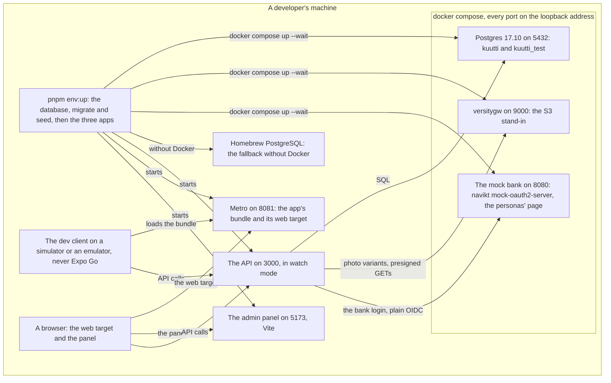
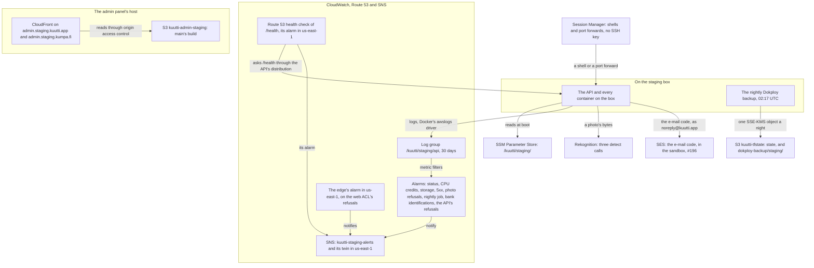
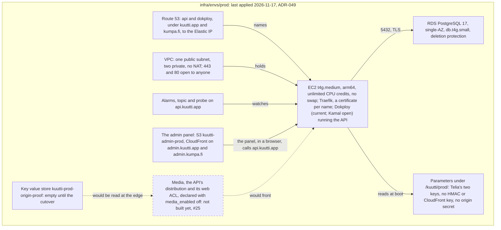
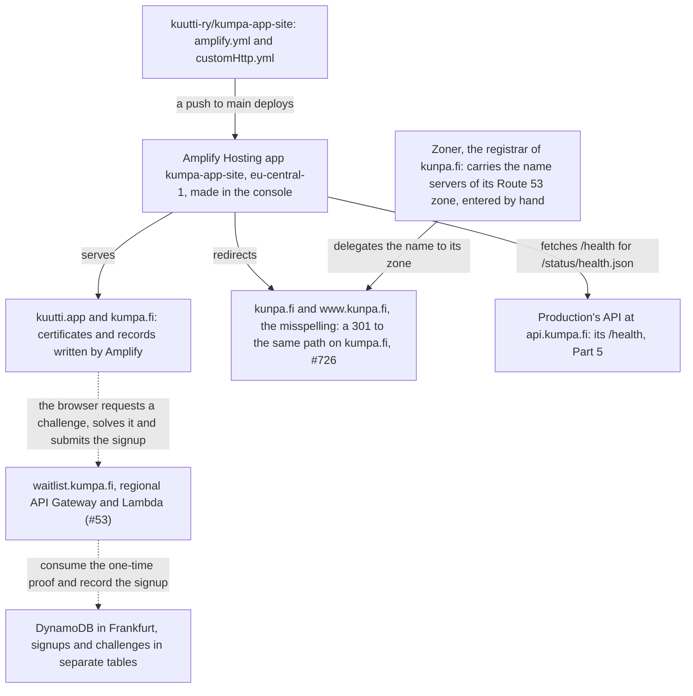

# Deployment

<!-- draws
docker-compose.yml
scripts/dev-env.ts
infra/envs/
infra/modules/
infra/bootstrap/
infra/scripts/dokploy-setup.sh
infra/scripts/db-app-role.sh
.github/workflows/demo-reset.yml
-->

Where each part of Kuutti runs, environment by environment: a developer's machine, staging and the services around its box, production as last applied, from a rehearsal tag, on 2026-11-17 (ADR-049), and the website. It is for a contributor who wants to know what a change will land on, and for a reviewer of `infra/`. Everything here is read from `infra/`, the workflows and the compose file on `main`; what is planned is dashed and names its issue. The deploy tool is drawn as it runs today, Dokploy, while Dokploy versus Kamal stays open. The view draws ADR-001, ADR-005, ADR-008, ADR-014, ADR-018, ADR-025, ADR-043, ADR-046, ADR-048, ADR-049, ADR-054, ADR-066, ADR-067, ADR-070 and ADR-072.

## Part 1: a developer's machine

### Steps

1. `pnpm env:up` starts the whole local environment. It brings up the database with `docker compose up -d --wait` when Docker is there, and Homebrew PostgreSQL otherwise. It frees a port held by a stale copy of one of our own processes and stops at anything else, migrates and seeds the database for development, then starts the API, Metro and the panel and waits until each answers. `pnpm env:down` stops the compose database; it leaves a shared Homebrew PostgreSQL running. A database already holding the compose port is named and left alone.
2. Postgres 17.10 in compose, published on port 5432 of the loopback address only, with the databases `kuutti` and `kuutti_test` (the second made once, when the volume is new).
3. versitygw, the S3 stand-in, on port 9000 of the loopback address, with the media bucket as a directory. Locally the API presigns its own GETs on it, where a deployed API signs CloudFront URLs.
4. The mock bank, `navikt/mock-oauth2-server`, on port 8080 of the loopback address, with the issuer `/ftn`. Its login page is ours: a button for each persona and a form for arbitrary claims shaped like Telia's (ADR-014).
5. Homebrew PostgreSQL: the fallback when docker compose is not available. The S3 stand-in and the mock bank stay down then.
6. The API on port 3000, run by Node in watch mode from source. In development it reads no parameter store, sends no mail (the message, code included, is written to its log) and no push (the kind of each is written to its log), and with no `MODERATION` set it never calls Rekognition.
7. Metro on port 8081: the app's bundle for the dev client and the web target of the same app.
8. The admin panel on port 5173, served by Vite. With no `VITE_API_URL` it talks to `http://localhost:3000`, and the API's development allowlist admits it and the web target.
9. The dev client: a development build of the app on an iOS simulator or an Android emulator, never Expo Go. The Maestro flows drive it against this same environment (ADR-020).
10. A browser: the app's web target, which runs against seed data and the mock bank and is not a product surface, and the admin panel.

## Part 2: staging, its network and its box

### Steps

11. Who reaches staging from outside: phones and browsers, Route 53's health checkers, and GitHub Actions, which deploys through Dokploy's API and, by hand, sends the demo's reset (step 60).
12. Route 53: `api.staging` and `dokploy.staging` are aliases (A and AAAA) of the API's distribution, since staging's `media_enabled` is on. Dokploy's moved there from the Elastic IP with #198, the record changed in place. Each host has a second name under `kumpa.fi`, written in that domain's zone with the same target (#703, ADR-072): staging's `extra_domains` gives them, `domain` stays `kuutti.app`, and nothing calls the second names before the switch.
13. Route 53: `origin.api.staging` is an A record to the box's Elastic IP, with a TTL of five minutes, under both domains; the distribution connects by the `kuutti.app` one. With media off, `api.staging` and `dokploy.staging` would be such records instead, and `origin.api.staging` would not exist under either.
14. CloudFront's default behaviour: every method, nothing cached, every viewer header and cookie forwarded with the ones CloudFront adds (the viewer's address, the WebSocket's headers), sent over HTTPS (TLS 1.2) to `origin.api.staging`, where Traefik routes the request by its forwarded Host. TLS for viewers ends here, with an ACM certificate from us-east-1 that names the distribution's four aliases, `api.staging` and `dokploy.staging` under both domains, each validated by a record in its own zone. A viewer-request CloudFront Function, `kuutti-staging-origin-proof`, removes any `x-kuutti-origin` the viewer sent and sets the store's value (step 63): the proof by which the API tells Kuutti's distribution from anybody's (ADR-066). Price class 100 (Europe and North America), HTTP/2 and HTTP/3, IPv6. Nothing may be cached on it: the API and Dokploy share it, and a cache key without the Host would hand one host's answer to another.
15. CloudFront's `/media/*` behaviour: GET and HEAD only, HTTPS only, and only with a URL signed by a key of the trusted key group. A variant is cached once however many URLs were signed for it: the query string is not part of the key.
16. The media bucket `kuutti-media-staging-<account>`: private, public access blocked, SSE-S3, versioning off so an erased photo is gone. Its policy admits only the distribution to `media/`; the instance role also writes, reads and removes variants there. Unfinished uploads go after a day.
17. The VPC: one /16 for the environment, an internet gateway for the public subnet's one route out, and no NAT gateway: the box is public and RDS makes no outbound connection, so the private subnets have only the local route. Its security group admits 443 from CloudFront's origin-facing prefix list alone (step 24), 80 from anywhere (for the ACME challenge and the redirect) and port 22 only from a list that is empty by default; Session Manager is the way in.
18. The box: EC2 `t4g.small`, arm64, Ubuntu 24.04 from Canonical's current image at the time it was built, an Elastic IP, IMDSv2 only with a hop limit of 2 so that containers reach the instance role, a 30 GB encrypted gp3 root volume, and standard CPU credits (it slows down rather than costs more). Its role is `kuutti-api-staging`, under the bootstrap's permissions boundary. A newer image or an edited first-boot script never replaces it; a rebuild is an explicit `-replace`.
19. Traefik, installed with Dokploy: it terminates TLS for the hosts the box serves, and routes by host. `dokploy.staging` and `api.staging`, under both domains, and `origin.api.staging.kuutti.app` each have a Let's Encrypt certificate of their own, by HTTP-01; for the names behind the distribution the challenge comes through it (step 61). `dokploy-setup.sh`, run once Dokploy has its owner and again after the second names (ADR-072 §3), gives the API's application both API hosts and writes a pair of routers with a high priority for every name of `dokploy.staging` and of `api.staging`, pinning each to Dokploy or to the API, so a token that may add domains cannot take any of them; a name of its own per pair, so that one name's failed renewal holds up no other. Before that, first boot leaves Traefik no route to Dokploy at all, since the first visitor of a Dokploy without an owner becomes it (ADR-048). `origin.api.staging` is a second domain of the API's application, given by hand at the media cutover, so that CloudFront can reach the box by that name.
20. Dokploy (current; Kamal open): version v0.30.6, from an installer vendored in `infra/modules/compute` and checked by its hash at first boot. It runs a one-node Docker Swarm with its own Postgres and Traefik. Port 3000 is never opened. Traefik serves Dokploy's UI and its API, which CI calls, at `dokploy.staging.kuutti.app`, Dokploy's own domain and the one CI calls, and at `dokploy.staging.kumpa.fi`, through the distribution (#198), reachable by anyone behind Dokploy's own login with two-factor authentication, and no longer on the box's own address (step 24); the Session Manager port forward is how the admin account was first made. Its own configuration is outside code, the one manual island of ADR-001, backed up every night (part 3). Docker logs every container to CloudWatch.
21. The `api` application: the API's image from GHCR, with the environment `NODE_ENV=production`, `APP_ENV=staging` and `PORT=3000`; everything else comes from the parameter store through the instance role. Staging holds no real person: Telia's test persons and the synthetic population only (ADR-018).
23. RDS PostgreSQL 17 (the major pinned, minor versions applied automatically), single-AZ, `db.t4g.micro`: gp3 storage from 20 GB growing to 100, encrypted, 35 days of point-in-time recovery, TLS forced, Extended Support declined, not publicly reachable, no deletion protection on staging. Its subnet group spans the two private subnets in the region's first two zones, as RDS requires even for one instance. Its security group admits 5432 from the box's security group alone. The master password is held by AWS; the API connects as `kuutti_app`.
24. Ingress from CloudFront alone (#198): `cloudfront_only_ingress` replaces the open 443 rule with CloudFront's origin-facing prefix list, once Dokploy's control plane was behind the distribution too (ADR-005 §7). A connection to the box's 443 from anywhere but a CloudFront server gets no answer; port 80 stays open to anyone (step 62). The list is every CloudFront distribution's, though, not this one's alone, and anybody's distribution may send `CloudFront-Viewer-Address` with a value of its own. So the rate limiter's `trusted-proxy`, `cloudfront` since 2026-11-06, believes that address only from a request carrying the proof of Kuutti's distribution (step 63, ADR-066); any other request has no address and shares the one bucket of no address. A precondition in the composition refuses `cloudfront` without the switch, and the API refuses it without the secret. The Route 53 probe asks for `"originProof":"valid"`, so a store and a parameter that disagree page someone.
25. Swap and the free memory (#77, ADR-046): a 2 GB `/swapfile` with `vm.swappiness = 10`, and `MemAvailable` pushed every minute to `Kuutti/staging/box` by a cron line, which the alarm `kuutti-staging-memory-low` reads (part 3). First boot runs the script; the running box got it from the Run Command document `kuutti-staging-headroom` on 2026-10-24. Dokploy runs without a memory limit (ADR-046 §2).
60. The Run Command document `kuutti-staging-demo-reset` (#613, ADR-018 §8): `demo-reset.yml`, from `main` every night at 02:17 in Helsinki and by hand ([Delivery](delivery.md), part 5), sends it as `kuutti-ci-plan`, which the bootstrap lets send exactly this document to exactly this box. It takes no parameter. On the box, as root, it finds the task of the `api` application and runs `node dist/demo-assets.js` and then `node dist/demo-reset.js --env staging` in the container, both reading staging's parameters through the instance role as the API does; the reset's exit code is the command's, 2 naming the personas it spared (a staff role or a line in the audit log, ADR-014 §12), 3 meaning no `api` container runs. Declared by staging alone (`demo_reset = true` in `envs/staging`); production has no such document, and its container refuses the command anyway (ADR-018 §3). The headroom document of step 25 is the box's third, sent by the maintainer alone.
61. CloudFront's `/.well-known/acme-challenge/*` behaviour (#198): GET and HEAD, plain HTTP allowed, nothing cached, and of what the viewer sent only the Host forwarded (no cookie, other header or query string; CloudFront adds the requester's address), to `origin.api.staging` on port 80 over HTTP. Under the default behaviour the challenge for a name behind the distribution would be redirected to HTTPS and answered by the API with a 404, so Traefik's certificates for `api.staging` and `dokploy.staging`, under either domain, could not renew. On port 80 Traefik's challenge router outranks every other router and answers only a token it is waiting for. The renewals matter because CloudFront accepts the box's certificate when it names either the origin or the forwarded Host, and AWS does not say which of the two it asks the box for.
62. Let's Encrypt: its HTTP-01 challenge for `api.staging` and `dokploy.staging`, under either domain, comes through the distribution (step 61), the one for `origin.api.staging.kuutti.app` straight to the box's port 80, which stays open to anyone for it and for the redirect to HTTPS.
63. The key value store `kuutti-staging-origin-proof` (#198, ADR-066): its one key, `origin-secret`, is the value the function of step 14 sends as `x-kuutti-origin`, and the API compares it with its own copy, the SecureString `origin-secret` of step 29. Both are written by hand, never by OpenTofu, so the value is in no state; CI's plan role may not read the store (`ci_plan_deny_data`), the maintainer's bootstrap applies that. In `cloudfront` mode a request without the proof has no address; in `traefik` mode the proof changes nothing the limiter does. `/health` says what the box sees: `trustedProxy` and `originProof` (`valid`, `missing`, `wrong`, `unset`). The store is the environment's, outside `modules/media`, so production's exists before its cutover.
64. The web ACL `kuutti-staging-edge` (#41, ADR-067), in us-east-1 as CloudFront's are, on the distribution: one rate-based rule refuses an address past 2,000 requests in any five minutes with 429, `Retry-After: 300` and the API's own envelope, `rate_limited` with `"requestId":"edge"`, until its count is under the limit again. The address is the one CloudFront took the connection from. It counts every request the distribution sends to the box, whatever the host, but two kinds, named in `modules/media/edge.json`: a signed photo, which never reaches the box, by the exact shape the API signs, since CloudFront picks a behaviour on the normalised path and sends the raw one on; and the two sign-in starts, which the API refuses with its own redirect (ADR-026 §4). A request through somebody else's distribution never meets it (step 24). It keeps metrics only: no WAF log and no sampled request, since both keep addresses, and CI's plan role may not read the list of addresses it is refusing. Its alarm is part 3's. The API's own windows come after it (ADR-026).
65. The IP set `kuutti-staging-edge-unlimited`: addresses the rule does not count, empty but for the load smoke's runner during a run's hour, written and removed by hand with the CLI ([capacity.md](../runbooks/capacity.md), Before a run, step 8). OpenTofu declares it and ignores what is in it, so no address is in the repository. IPv4 only; a run goes over IPv4.

## Part 3: staging, the services around the box

### Steps

26. The API and every other container on the box: Docker's default log driver is `awslogs`, set before Dokploy's installer starts a single container.
27. The nightly backup: a cron job at 02:17 UTC packs `/etc/dokploy` (Traefik's configuration and certificates, the applications) with a dump of Dokploy's database and puts it, encrypted with SSE-KMS, under `dokploy-backup/staging/` of the state bucket. The box may write its own prefix, never read, list or delete it, since every container on the box holds its role; a rebuild fetches the backup through a link the maintainer presigns (ADR-054). The plan role, denied `kms:Decrypt`, cannot read it.
28. Session Manager: the way onto the box, as `ssm-user`, and the port forward to Dokploy's UI. Staging declares the account's session preferences: every session is streamed to the log group `/kuutti/ssm-sessions`, kept 90 days, so nothing secret is ever printed in one.
29. SSM Parameter Store, `/kuutti/staging/`: the non-secret parameters `infra/envs/staging` writes (`app-env`, `log-level`, the database's `db-*`, `moderation`, `mail`, `push`, `admin-app-url`, `cors-allowed-origins`, `trusted-proxy`, the media's three, and the bank's four: Telia's pre-production issuer, its client id, the callback and the level), and the secrets made by hand, never resources (the hetu HMAC key, the two Telia keys, the CloudFront signing key, the database password, the origin secret of ADR-066, and Expo's access token once EAS's enhanced push security is on, #102), with Sentry's public DSN, also put by hand. The box's role reads this prefix only and is denied every other, `/kuutti/prod/` included.
30. CloudWatch Logs: `/kuutti/staging/api`, one stream per container name, kept 30 days, with five saved Logs Insights queries (errors by route, latency by route, boot, bank identifications by platform, refusals by route).
31. The alarms: `kuutti-staging-instance-status-check-failed`, `-instance-cpu-credits-low`, `-db-cpu-credits-low`, `-db-free-storage-low`, `-api-5xx`, `-photo-budget-refusals`, `-nightly-job-failed`, `-bank-identifications`, `-api-refusals` and `-memory-low`: five on metric filters over the API's log, the last on the box's own push to `Kuutti/staging/box`. `-api-refusals` counts the API's 429s and its `sign-in refused` lines (#41, ADR-026 §7). The edge's, `kuutti-staging-edge-rate-limited`, counts the web ACL's refusals (step 64) in us-east-1, where AWS WAF publishes a CloudFront web ACL's metrics, and mails at any.
32. The outside probe: a Route 53 health check of `https://api.staging.kuutti.app/health` every 30 seconds from eu-west-1, us-east-1 and ap-southeast-1, wanting `"originProof":"valid"` in the body of a 2xx or 3xx answer, which `/health` gives only while its status is ok (ADR-066); three failures in a row fire `kuutti-staging-api-unreachable`, whose metric and alarm live in us-east-1.
33. SNS: `kuutti-staging-alerts` in eu-central-1 for the alarms, and a topic in us-east-1 for the probe's alarm and the edge's, both mailing the repository variable `ALERT_EMAIL` once its subscription is confirmed by hand.
34. The panel's distribution on `admin.staging.kuutti.app` and, as its second name, `admin.staging.kumpa.fi` (ADR-072): an ACM certificate from us-east-1 that names both, each validated in its own zone, the managed `CachingOptimized` policy, the panel's response headers on every answer (a CSP whose only connection is the staging API, by the `kuutti.app` name the build calls, under either of the panel's names, and whose one font is the panel's own, HSTS, `X-Frame-Options: DENY`, `X-Robots-Tag: noindex, nofollow` and the rest of ADR-025 §3), and 403 and 404 answered by `/index.html` so that a page's path loads the panel. It keeps no access log.
35. The panel's bucket `kuutti-admin-staging-<account>`: private, SSE-S3, no versioning, read by the distribution alone. CI writes `main`'s build at its root, and nothing else. `fonts/saiga-<version>/` holds Saiga's faces, which the maintainer uploads by hand from a laptop (`pnpm fonts -- --upload <bucket>`) and no deploy touches (ADR-052).
36. The state bucket `kuutti-tfstate-<account>`, made by the bootstrap: OpenTofu's state for the bootstrap, staging and production, the Dokploy backups and the weekly GitHub export. Versioned, encrypted, public access blocked.
37. Rekognition: `DetectModerationLabels`, `DetectFaces` and `DetectLabels`, on because staging's `moderation` parameter says `rekognition`.
38. SES: the role may send as `noreply@kuutti.app` or `noreply@kumpa.fi`, each through its own domain's identity (`mail_domains`), on staging only to what `MAIL_TESTERS` matches (`*@kuutti.app` since 2026-10-25; the two `noreply@` addresses alone while it is unset), and the parameter `mail` is `ses`. The identities are in `infra/bootstrap`, which only the maintainer applies. He applied `kuutti.app`'s on 2026-10-25, and SES verified the domain, its DKIM and the MAIL FROM `mail.kuutti.app` (#385, ADR-043). `kumpa.fi`'s, with the MAIL FROM `mail.kumpa.fi`, is declared for the move of ADR-072 and waits for his apply; nothing sends as it until `MAIL_FROM` names it (ADR-072 §7). SES is in its sandbox, which delivers only to verified identities, until production access is requested (#196).

## Part 4: no previews

A pull request deploys nothing before it merges (ADR-070, #705): no copy of the API on the staging box, no database of its own, nothing on EAS Hosting or EAS Update and nothing in the panel's bucket. Until 2026-11-16 this part drew those previews (ADR-012, ADR-053, both superseded). The part keeps its number, so that references to parts 5 and 6 still hold.

## Part 5: production

### Steps

49. Route 53: `api.kuutti.app` and `dokploy.kuutti.app` as A records to production's Elastic IP, with a TTL of five minutes, and since 2026-11-17 `api.kumpa.fi` and `dokploy.kumpa.fi` beside them in their own zone, with the same target (#703, ADR-072). Once media is on, `api` and `dokploy` under both domains become aliases of production's distribution, Dokploy's as its extra aliases (#198), and `origin.api` takes `api`'s place at the Elastic IP, so production's cutover needs no follow-up before its ingress switch. The panel's names are its own distribution's (step 56).
50. The same network module as staging, with its own /16: one public subnet, two private, no NAT. The box's security group admits 443 and 80 from anywhere while `cloudfront_only_ingress` is off, and port 22 from nobody, since its list is empty; Session Manager is the way in.
51. The same compute module: a `t4g.medium` since 2026-11-05, when the apply of `v0.108.2-rehearsal.1` resized the `t4g.small` of 2026-10-24 in place (ADR-049 §4), arm64, with unlimited CPU credits (the module's default, where staging asks for standard). No Session Manager preferences, which staging owns for the account. Its role `kuutti-api-prod` reads `/kuutti/prod/` and is denied every other prefix, `/kuutti/staging/` included, and may send as `noreply@kuutti.app` or `noreply@kumpa.fi`, each through its domain's identity, to any address. No swap, so that swap never pages a hetu or the HMAC key to the disk (rule 1, ADR-046), which is what the larger box is for: with the API running, the `t4g.small` had about 270 MiB available on 2026-10-24, against the memory alarm's 200, and the `t4g.medium` had 2,145 to 2,358 MiB from 2026-11-17 to 2026-11-20. Traefik holds a Let's Encrypt certificate of its own for each of the four names of step 49, by HTTP-01 on port 80. Dokploy (current; Kamal open) as on staging, its owner made through the port forward while nothing public reached it (ADR-048, checked from outside at the first boot). `dokploy-setup.sh prod`, run again on 2026-11-17 after the apply that made the `kumpa.fi` records, gave the API's application both API hosts and pinned each name of `api` and `dokploy` to the API or to Dokploy (part 2, step 19). Its one application, `api`, runs the API pinned to a commit whose image's attestation was verified, deployed by hand (ADR-049 §2): since 2026-11-17, `main`'s image of the commit `v0.126.0-rehearsal.1` was cut on, which `/health` names under both of the API's names.
52. RDS PostgreSQL 17, single-AZ, `db.t4g.small`, with deletion protection and a final snapshot, `kuutti-prod-final`. The rest is staging's data module: gp3 storage from 20 GB growing to 100, encrypted, 35 days of point-in-time recovery, TLS forced, not publicly reachable.
53. The parameters: `app-env` `production`, `moderation` `rekognition`, `mail` `ses`, no `push` yet (it comes with Expo's access token, #102), `admin-app-url` `https://admin.kuutti.app`, `cors-allowed-origins` that and, since 2026-11-17, `https://admin.kumpa.fi`, `trusted-proxy` `traefik`. The bank's production issuer and its level are written only together with Telia's production client id, which `infra/envs/prod` names since 2026-11-24; the last apply predates it, so the API boots with bank identification off until the next one, which needs `hetu-hmac-key` first (the API refuses half a configuration). `db-app-password` is the one secret made by a script, `db-app-role.sh`; Telia's two keys, `telia-signing-key` and `telia-encryption-key`, were written with the CLI from the offline medium on 2026-11-24 (`telia-keys.sh`); no HMAC or CloudFront key, origin secret or Sentry DSN exists for production yet (ADR-049 §1), so error reporting is off as well (#201). Beside them, written with the CLI on 2026-11-18 and not resources: `ios-team-id` and `android-cert-fingerprints`, the two of the verified links (ADR-074).
54. The same observability module: ten alarms in eu-central-1, among them `kuutti-prod-memory-low` on the box's own push, `kuutti-prod-bank-identifications` since 2026-11-05 and `kuutti-prod-api-refusals` since 2026-11-17, and the probe's `kuutti-prod-api-unreachable` in us-east-1, all OK on 2026-11-20. The topic `kuutti-prod-alerts` and its twin in us-east-1 mail the repository variable `ALERT_EMAIL`, both subscriptions confirmed on 2026-11-05. The outside probe asks `https://api.kuutti.app/health` for `"status":"ok"`, since production has no proof of its distribution to ask for (ADR-066).
55. The media module is declared, but `media_enabled` is off: no media bucket, no API distribution and no web ACL (ADR-067, 2,000 requests in five minutes as on staging), until production's own cutover, so the API boots with photos off. Its edge alarm comes with it.
56. The panel's host, `modules/admin` (ADR-025), as on staging (part 3, steps 34 and 35): the bucket `kuutti-admin-prod-<account>` and a distribution on `admin.kuutti.app`, the address production's parameters name, created by the apply of `v0.108.2-rehearsal.1` on 2026-11-05, with `admin.kumpa.fi` as its second name since that of `v0.125.0-rehearsal.1` on 2026-11-17 (ADR-072): an ACM certificate from us-east-1 that names both, A and AAAA aliases in each zone, and the panel's response headers, whose CSP lets it connect to `https://api.kuutti.app` alone, under either name. The API answers the preflight of both origins (step 53). `admin-deploy.yml` writes the build to it, started by hand from a rehearsal tag, since the release gate stops `deploy prod` before it (ADR-049 §2): from `v0.108.2-rehearsal.1` on 2026-11-05 and from `v0.126.0-rehearsal.1` on 2026-11-17 ([Delivery](delivery.md), part 3). Saiga's faces are in its `fonts/`, uploaded by hand (ADR-052).
70. The key value store `kuutti-prod-origin-proof` (ADR-066), made by the apply of 2026-11-17 and empty on 2026-11-20. It is the environment's, outside `modules/media`, so that the cutover can write its key `origin-secret` by hand, with the SecureString of the same name, before the tag that turns the distribution on and `trusted_proxy` to `cloudfront` (part 2, step 63). Nothing reads it before then: the CloudFront Function that would is module media's.

Production is applied by `infra-prod.yml` on a `v*` tag, behind the `prod` environment's reviewer ([Delivery](delivery.md), part 3). Staging was applied first. Production was first applied on 2026-10-24 from the tag `v0.64.8-rehearsal.1`, before the first release and without bank identification, and stays up (ADR-049). `v0.108.2-rehearsal.1` applied it again on 2026-11-05, and `v0.125.0-rehearsal.1` on 2026-11-17, which is what this part draws; the run of `v0.126.0-rehearsal.1`, cut that day for the panel and the API, was cancelled, since nothing under `infra` or `.github` differed from the tag before it. Between tags it lags `main`: a pull request plans it, and only the next tag and its approval apply it (ADR-049 §5).

## Part 6: the website

### Steps

57. The website's own repository, `kuutti-ry/kumpa-app-site`: its `amplify.yml` is the build spec and its `customHttp.yml` the headers.
58. The Amplify Hosting app `kumpa-app-site` in eu-central-1, connected to that repository through the Amplify GitHub App: the console-made exception of ADR-001, since the connection is a browser consent no provider performs. A push to the site's `main` deploys it.
59. `kuutti.app`, the home, and `kumpa.fi`, the same site since 2026-11-16: Amplify issued the certificates and wrote the validation and alias records into each zone itself, outside OpenTofu. The redirects from `www`, the status rewrite (step 69) and the cost tag are commands in `infra/README.md`, run after the console.
67. `kunpa.fi`, the misspelling of `kumpa.fi` with an n, and `www.kunpa.fi` (#726): a third custom domain of the same app, which serves no page. Amplify holds a certificate for both names and answers a request over https with a 301 to the same path and query on `https://kumpa.fi`, by two rules beside the ones for `www`; a request over http is first sent to https under the same name. Its zone is the one the bootstrap creates and does not adopt (`infra/bootstrap/dns.tf`): it holds the alias, `www` and validation records Amplify wrote, and a null MX, an SPF that admits nobody, a reject DMARC and a CAA for Amazon's issuers, since the name has no mail.
68. Zoner, a Finnish registrar, where `kunpa.fi` is registered since 2026-11-17, the one registration outside Route 53. Its Nameserver page carries the four name servers of the zone (the bootstrap's output `kunpa_name_servers`), entered by hand. Zoner's own forwarding is not used: it answers on http alone, with a certificate for its own name over https.
69. Production's API at `api.kumpa.fi`, the box of Part 5. The site's status panel reads `/status/health.json` on the site's own origin, the only one its content security policy lets it reach. The app's fifth rule, a 200 rewrite set on 2026-11-20, answers that path on `kuutti.app` and `kumpa.fi` with what Amplify fetches from `https://api.kumpa.fi/health`, with no credential. It stays one exact path: the site's origin on the API's CORS allowlist would be answered on every route, and a wildcard would make the site a browser client of the product (rule 8). At production's cutover (#25), `api.kumpa.fi` becomes an alias of the API's distribution, whose edge rule counts `/health` by the address CloudFront took the connection from (ADR-067), here Amplify's. A flood of the site's path could then earn that address five minutes of 429s, which the panel shows as unknown, so the cutover checks the path again.

71. The website's script automatically requests a challenge at `POST /challenge`, computes its SHA-256 proof and submits it to `POST /join` with the email and language. The two POST routes on the default stage invoke the collector Lambda. Production provisions the certificate, DNS, regional API and Lambda independently of the product API.
72. The Lambda can write a signup, and create and consume challenge rows. The separate production tables expire signups after 365 days and challenges after ten minutes. The operator handles withdrawals and the launch-related updates as described in [Website launch notifications](../../infra/README.md#website-launch-notifications).

## Where it lives

- Local: [docker-compose.yml](../../docker-compose.yml), [scripts/dev-env.ts](../../scripts/dev-env.ts), [services/mock-idp](../../services/mock-idp), [apps/admin/src/lib/api.ts](../../apps/admin/src/lib/api.ts)
- Staging and production: [infra/envs/staging](../../infra/envs/staging) and [infra/envs/prod](../../infra/envs/prod) (`main.tf`, `dns.tf`, `variables.tf`); the modules [network](../../infra/modules/network), [compute](../../infra/modules/compute) (with its first-boot script and the vendored Dokploy installer), [data](../../infra/modules/data), [media](../../infra/modules/media), [admin](../../infra/modules/admin), [observability](../../infra/modules/observability); [infra/bootstrap](../../infra/bootstrap) (the state bucket, the zones, the SES identities, the CI roles); [infra/scripts/dokploy-setup.sh](../../infra/scripts/dokploy-setup.sh), [db-app-role.sh](../../infra/scripts/db-app-role.sh)
- The demo's reset: [.github/workflows/demo-reset.yml](../../.github/workflows/demo-reset.yml), the document in [compute](../../infra/modules/compute) and its right in [bootstrap](../../infra/bootstrap) (ADR-018 §8)
- The manual: [infra/README.md](../../infra/README.md) (Environments, Media, Mail, Admin panel, Observability, Backups and rebuilding the box, Secrets, The website), [docs/runbooks/incident.md](../runbooks/incident.md)
- ADRs: [ADR-001](../adr/001-infrastructure-as-code.md) (OpenTofu; Dokploy's configuration as the manual island), [ADR-005](../adr/005-media-pipeline-and-delivery.md) (the distribution, §7 the ingress switch), [ADR-008](../adr/008-exposure-budget-and-client-address.md) §5 (the trusted proxy), [ADR-014](../adr/014-demo-mode.md) (the mock bank), [ADR-018](../adr/018-staging-is-the-demo.md) (staging holds no real person; §8 the reset from a workflow), [ADR-020](../adr/020-end-to-end-flows-with-maestro.md) (the flows on the local environment), [ADR-025](../adr/025-admin-host.md) (the panel's host), [ADR-043](../adr/043-email-confirmation.md) §5 and §6 (SES and staging's testers), [ADR-046](../adr/046-box-headroom.md) (swap and the memory alarm), [ADR-048](../adr/048-dokploy-owner-first.md) (nothing public before Dokploy's owner), [ADR-049](../adr/049-production-before-the-first-release.md) (production before the first release), [ADR-054](../adr/054-backup-write-only.md) (the box writes its backup and never reads it), [ADR-066](../adr/066-the-box-knows-kuuttis-distribution.md) (the proof of Kuutti's distribution), [ADR-067](../adr/067-the-edge-refuses-an-address-that-floods.md) (the edge's rate rule), [ADR-070](../adr/070-no-pull-request-previews.md) (no pull-request previews), [ADR-072](../adr/072-two-names-then-kumpa-alone.md) (two names, then `kumpa.fi` alone)
- Issues: #198 (ingress from CloudFront alone), #77 (swap and the memory alarm, ADR-046), #25 (production), #385 and #196 (SES), #703 (the second names)

## Open

- Production's ingress (#25, #198): its box admits 443 from anywhere until its cutover, which sets `media_enabled`, `cloudfront_only_ingress` and `trusted_proxy` together and so waits for the viewer address's proof below, unless the maintainer accepts the shared edge bucket in production too (`infra/README.md`, Media).
- Production's viewer address (#25, ADR-066 §6): production stays on `traefik` until its cutover, which fills its store, there and empty since 2026-11-17 (step 70), and SSM first and checks the proof between the tag's apply and its deploy.
- Production (#25) runs without bank identification (ADR-049) and without swap (ADR-046), on the `t4g.medium` since 2026-11-05 (step 51). Its API and its panel are deployed by hand from rehearsal tags until a tag passes the release gate ([Delivery](delivery.md), part 3).
- SES (#196): the account is in SES's sandbox until the maintainer asks AWS for production access, so production as well delivers only to verified identities, the addresses of `kuutti.app` and of `kumpa.fi` among them; both domains are verified identities.
- The second names (#703, ADR-072) exist in both environments since 2026-11-17: the maintainer applied the bootstrap, staging through `infra.yml` and production at `v0.125.0-rehearsal.1`, and ran `dokploy-setup.sh` after each. The switch to `kumpa.fi` waits for Telia's answer and the Workspace alias, and `kuutti.app`'s hosts retire once no installed build calls them (§7, §8).
- Dokploy versus Kamal is open (CLAUDE.md, Decisions); Dokploy's configuration is the one part of the box outside code.
