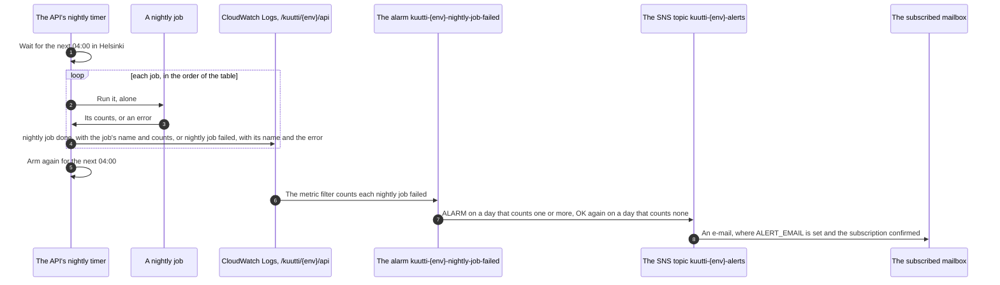
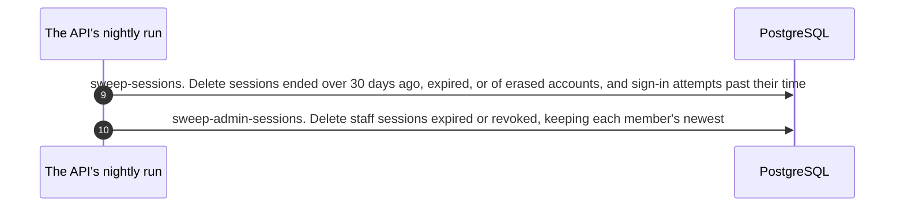
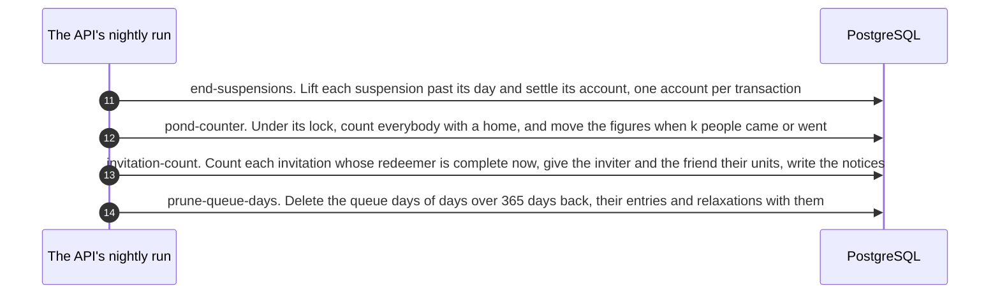
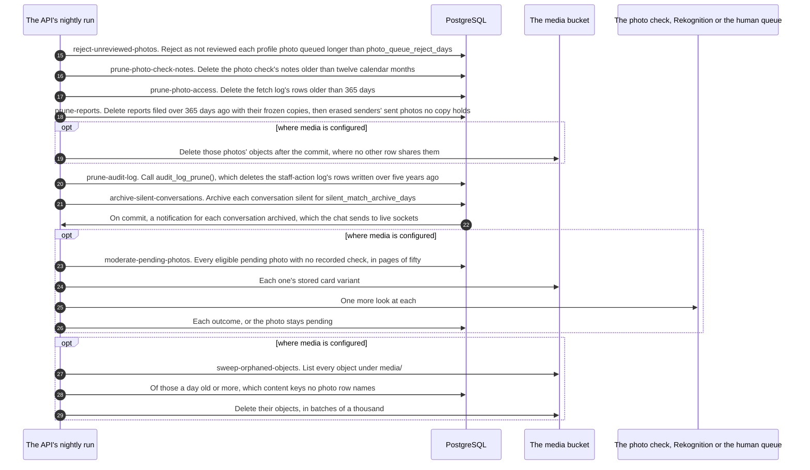

# The night's jobs, step by step

<!-- draws
apps/api/src/jobs/nightly.ts
apps/api/src/boot.ts
infra/modules/observability/
-->

What the API does at night, from the system's side: the timer that runs inside the API's own process at 04:00 in Helsinki, the fourteen jobs it runs one after another, what each reads and writes, and how a failed job reaches the maintainer's mailbox through the log and an alarm. It is written for a contributor who adds or changes a job, and for whoever answers the alarm. There is no cron and no second process: the jobs are listed in the API's boot and run by a timer in the same process as HTTP and the socket. This view draws ADR-006 §2 and §6, ADR-008 (the fetch log's year), ADR-013, ADR-015, ADR-024 §5, ADR-030 §8, ADR-031 §8, ADR-044 §7 and ADR-062 §1 and §13, and ADR-076. Nothing of the queue is built at night: the first read of a Finnish day opens a person's log, and what the night does for queue days is delete those past their year.

In these diagrams every arrow is built. Mermaid's sequence diagrams take a message's words as they are, so the labels are not in quotes, and they name an environment as `{env}`, staging or prod.

## The jobs, in order

"Everywhere" is every process the API runs in: staging and a developer's machine. Production runs the same list.

| # | Job, as the log names it | Where the work lives | Reads | Writes | Runs |
|---|---|---|---|---|---|
| 1 | `sweep-sessions` | identity | sessions, sign-in attempts | deletes ended, expired and erased sessions, and expired sign-in attempts | everywhere |
| 2 | `sweep-admin-sessions` | identity | staff sessions | deletes expired or revoked staff sessions, each member's newest kept | everywhere |
| 3 | `end-suspensions` | safety | sanctions | lifts each suspension past its day, settles the account | everywhere |
| 4 | `pond-counter` | jobs | accounts, profiles, photos, preferences | the day's figures, one row | everywhere |
| 5 | `invitation-count` | rewards | invitations, accounts, consents, profiles, photos, preferences | invitations counted, both people's reward units, the notices | everywhere |
| 6 | `prune-queue-days` | matching | queue days | deletes the queue days of days over 365 days back, their entries and relaxations with them | everywhere |
| 7 | `reject-unreviewed-photos` | media | profile photos in the human queue | rejects those waiting past `photo_queue_reject_days` as not reviewed | everywhere |
| 8 | `prune-photo-check-notes` | safety | the photo check's notes | deletes notes older than twelve calendar months | everywhere |
| 9 | `prune-photo-access` | media | the fetch log of signed photo URLs | deletes rows older than 365 days, every account's | everywhere |
| 10 | `prune-reports` | safety | reports, their frozen copies, erased senders' sent photos | deletes reports older than 365 days, then the photos no copy holds, then their objects | everywhere; the objects where media is configured |
| 11 | `prune-audit-log` | safety | the staff-action log | deletes rows written more than five years ago, through the database's own `audit_log_prune()` | everywhere |
| 12 | `archive-silent-conversations` | chat | conversations | archives the silent ones | everywhere |
| 13 | `moderate-pending-photos` | media | photos pending with no recorded check, their stored card variant | the check's outcome | where media is configured |
| 14 | `sweep-orphaned-objects` | media | every object under `media/`, the photo rows | deletes the objects a day old or more whose content key no photo row names | where media is configured |

## Part 1: the run, and a failure

### Steps

1. Each API process arms one timer at its start, for the next 04:00 in Helsinki (`NIGHTLY_HOUR`). The timer does not keep the process alive by itself. Two containers that overlap during a deploy each arm one; the jobs that must not run twice at once take an advisory lock in the database (steps 12 and 13).
2. The jobs run one at a time, in the order of the table: each waits for the one before it. A rejected operation is caught and the chain continues; a never-settling operation still holds the chain. There is no uncancellable timeout that lets its writes overlap the following job.
3. A job answers with counts, never with who: how many sessions, days, photos; the counter's with the day and whether its figures moved. A job that throws answers with its error.
4. One line per job: `nightly job done` with the job's name and its counts, or `nightly job failed` with its name and the error, which the logger redacts as everywhere. A failure is logged, never thrown, so one broken job stops neither the next job nor the server. On a deployed box Docker's `awslogs` driver sends every container's lines to the log group `/kuutti/{env}/api`, one stream per container, kept 30 days. On a developer's machine the lines go to the terminal.
5. After the last job the timer is armed again for the next 04:00.
6. A metric filter on the log group counts each `nightly job failed` line as `NightlyFailures`.
7. The alarm `kuutti-{env}-nightly-job-failed` sums a day: one or more is ALARM, and a day with none is OK again. Both go to the environment's topic.
8. The topic mails the address in the repository variable `ALERT_EMAIL`, once its subscription is confirmed from that mailbox; without the variable the topic has no subscriber. `docs/runbooks/alerts.md` has the first steps.

## Part 2: sessions

### Steps

9. `sweep-sessions` (identity, #35): deletes the sessions revoked more than 30 days ago, those past their expiry, and those of erased accounts; and the sign-in attempts past their time. A deleted session also closes any socket it still had (see Chat, step 42).
10. `sweep-admin-sessions` (identity, #49): deletes staff sessions that expired or were revoked, keeping each member of staff's newest.

## Part 3: the pond, and the queue days past their year

### Steps

11. `end-suspensions` (safety, #307, ADR-024 §5): every suspension still open past its day is lifted by nobody, and its account's state settled from the sanctions still open, one account per transaction. A failure is collected while the remaining accounts are still attempted, then reported through the runner. It runs before the counts so that a person let back in is counted the same night. A login on the end day before 04:00 is still refused: a `shortcut:` in `safety/sanctions.ts`.
12. `pond-counter` (`jobs/`, #54, ADR-013): under its own advisory lock, counts the finished profiles: live, bank-verified accounts with a home that stand as active and have a complete profile, reading nobody's gender (#581). The number moves only when at least k people have come or gone since it was taken, and the bands of whom the finished profiles seek on their own (#507). One row holds what stands (#607). The counter's route serves the number all day, and to the session of somebody with a home the bands, as shares. A database with no figures gets its first ones at boot.
13. `invitation-count` (rewards, #107, ADR-044 §7, ADR-060 §7): in one transaction, each invitation not counted yet whose redeemer's profile and onboarding are complete now is counted once; its inviter and the friend who used it get the units `matching_config invitation_reward` says tonight, with both people locked first. The inviter gets one notice in the app even of nothing, and the friend one only of a fish (ADR-032). Its line says how many and of what, never who.
14. `prune-queue-days` (matching, #502, ADR-062 §13): the queue days of Finnish days more than 365 days back are deleted, and their entries and relaxations go with them by the cascade. The year covers the longest clock of the queue's ladder, a second pass. Nothing else is done for the queue at night: `GET /queue/today` opens a person's log at their first read of the day and adds the next people as they read (ADR-062 §1), and no push tells of it (ADR-062 §12).

## Part 4: photos, reports, the audit log and silent conversations

### Steps

15. `reject-unreviewed-photos` (media, #376, ADR-006 §2): a profile photo in the human queue that nobody decided within `matching_config photo_queue_reject_days` is rejected as `not_reviewed`, a reason no moderator chooses. Nothing expires into visibility: the photo stays in its owner's list with the reason. The value 0 turns the job off.
16. `prune-photo-check-notes` (safety, #253): the photo check's notes, which kind of photo the check did not show and when, are kept twelve months.
17. `prune-photo-access` (media, #688, ADR-008 History 16/11/2026): the fetch log, one row per signed photo URL, is kept a year; rows older than 365 days go, every account's, found by their time alone through `photo_access_at_idx`. Today's rows, which the budget and the velocity rule count, are never near it.
18. `prune-reports` (safety, #84, #351, ADR-030 §8 and §12): in one transaction, every report filed more than twelve months ago goes, open or decided, with its frozen copy of a conversation; its block stays. Then every photo an erased person sent in a conversation that no copy holds any more goes, through the media slice's own erasure.
19. After the commit, where media is configured, those photos' objects are deleted from the media bucket where nothing else shares them.
20. `prune-audit-log` (safety, #714, ADR-076, ADR-006 §6): the staff-action log is kept five years. The job calls the database's own `audit_log_prune()`, which runs as the table's owner, takes no argument and deletes the rows written more than five years ago by the database's clock; the table's trigger lets those deletes through and refuses every other change. Its line says how many went. The first rows are from October 2026, so it deletes nothing before October 2031.
21. `archive-silent-conversations` (chat, #348, TD-13, ADR-031 §8): in one transaction, the conversations with no message and no contact shared for `matching_config silent_match_archive_days` are locked, read afresh and archived, so one that a share brought back while the lock waited stays out. A closed conversation stays as it is, and a break stops no clock (ADR-022 §4).
22. On commit, the conversation trigger notifies `kuutti_chat`, and the chat tells each side's live sockets that the conversation is archived (see Chat, steps 40 and 41). The next message brings it back.
23. `moderate-pending-photos` (media, #49, ADR-006), where media is configured: every photo still pending with no check recorded, pending for more than ten minutes (a crash or a failed call), gets one more look, in pages of fifty ordered by creation time and id.
24. The job reads each one's stored card variant from the bucket; one with no card variant is logged and counted as failed.
25. The check is Rekognition through the instance role where `MODERATION=rekognition`, and otherwise the human queue for everything (ADR-006 §4).
26. Each outcome is written as the upload's would be. A photo the check cannot reach stays pending and does not keep later pages out: nothing expires into visibility.
27. `sweep-orphaned-objects` (media, #636, ADR-007), where media is configured, last: lists every object under `media/` in the bucket, a thousand a page.
28. Of those written a day or more ago and of the variant shape, `media/<content key>/<variant>.webp`, with `variant` one of `thumb`, `card`, `full`, it asks the `photo` table which content keys no row names. An object under `media/` of another shape is counted, left and said in a warning: not this job's to judge.
29. Their objects are deleted in batches of a thousand, as erasure's are. The answer is counts, never a key: the objects seen, the aged ones, the orphaned keys, the objects deleted, the unexpected. A day's grace keeps an upload's objects until its row is in; what a failed delete, a failed upload cleanup or a crash between the two left behind goes the first night it is a day old: the same night for an object that aged long before its delete failed, the next for a fresh one.

## Where it lives

- The timer and the list: `apps/api/src/jobs/nightly.ts` (`msUntilNightly` over `msUntilFinnishHour`, which a push's time to live uses too, `runNightly`, `scheduleNightly`), `apps/api/src/boot.ts` (the jobs, in order), `apps/api/src/index.ts` (`scheduleNightly` at start)
- The jobs: `apps/api/src/identity/sessions.ts` and `admin-session.ts`; `apps/api/src/safety/sanctions.ts` (`endSuspensions`), `photo-check.ts`, `reports.ts` (`pruneReports`), `audit.ts` (`pruneAuditLog`) with `audit_log_prune()` in `packages/db/drizzle/0014_audit_log_prune.sql`; `apps/api/src/jobs/pond-counter.ts`, `pool.ts`, `invitation-count.ts` with `apps/api/src/rewards/invitations.ts`; `apps/api/src/matching/queue.ts` (`pruneQueueDays`); `apps/api/src/media/moderation.ts` (`rejectUnreviewedPhotos`, `sweepPendingPhotos`), `repo.ts` (`prunePhotoAccess`); `apps/api/src/chat/archive.ts`; `apps/api/src/media/erasure.ts` (`sweepOrphanedObjects`).
- The alarm: `infra/modules/observability/main.tf` (the topic, the e-mail subscription, the metric filter `nightly-failures`, the alarm `nightly-job-failed`), `infra/modules/compute/main.tf` and `templates/user_data.sh.tpl` (the log group and the `awslogs` driver), `infra/envs/staging/main.tf` and `infra/envs/prod/main.tf` (each composes it), `docs/runbooks/alerts.md`
- Specs: `features/identity/erasure.feature` (the sweep), `features/safety/sanctions.feature` (the night lifts a suspension), `features/safety/audit.feature` (the night deletes the audit rows past five years), `features/pond/opening.feature`, `features/pond/counter.feature`, `features/matching/decisions.feature`, `features/media/moderation.feature`, `features/chat/conversations.feature`
- ADRs: [ADR-007](../adr/007-erasure-and-export.md) (the sweep), [ADR-008](../adr/008-exposure-budget-and-client-address.md) History 16/11/2026 (the fetch log's year), [ADR-006](../adr/006-photo-moderation.md) §2, §4 and §6, [ADR-013](../adr/013-waitlist-counter.md), [ADR-060](../adr/060-no-waiting-at-the-pond.md), [ADR-022](../adr/022-taking-a-break.md) §4, [ADR-024](../adr/024-sanctions.md) §5, [ADR-030](../adr/030-reports-and-blocks.md) §8 and §12, [ADR-031](../adr/031-chat.md) §8, [ADR-032](../adr/032-notification-choices-and-notices.md), [ADR-034](../adr/034-the-queue-record.md) §7, [ADR-044](../adr/044-invitations.md) §7, [ADR-062](../adr/062-one-queue.md) §1 and §13, [ADR-076](../adr/076-the-audit-log-keeps-five-years.md)
- Issues: #35, #49, #54, #84, #107, #253, #307, #348, #351, #376, #500, #502, #636, #688, #714; the alarm #11

## Open

- Nothing. Production runs every job since research left the night (#208, ADR-071).

## History

- 2026-11-13 (#380): show all retry pages, failure isolation, calendar-month note retention and the next-run cutoff for the existing ninety-day research bound; clarify the awaited runner’s hang limitation.
- 2026-11-16 (#688): `prune-photo-access` joins the night as job 12, after the photo check's notes: the fetch log is kept a year. Part 4's steps from 25 on move up by one.
- 2026-11-16 (#208, ADR-071): the three research jobs leave the night, and the alarm's second line with them. Thirteen jobs; part 2 draws the sessions alone, and the steps from 11 on move up by eight.
- 2026-11-18 (#714, ADR-076): `prune-audit-log` joins the night as job 11, after the reports: the staff-action log is kept five years. Fourteen jobs; part 4's steps from 20 on move up by one.
