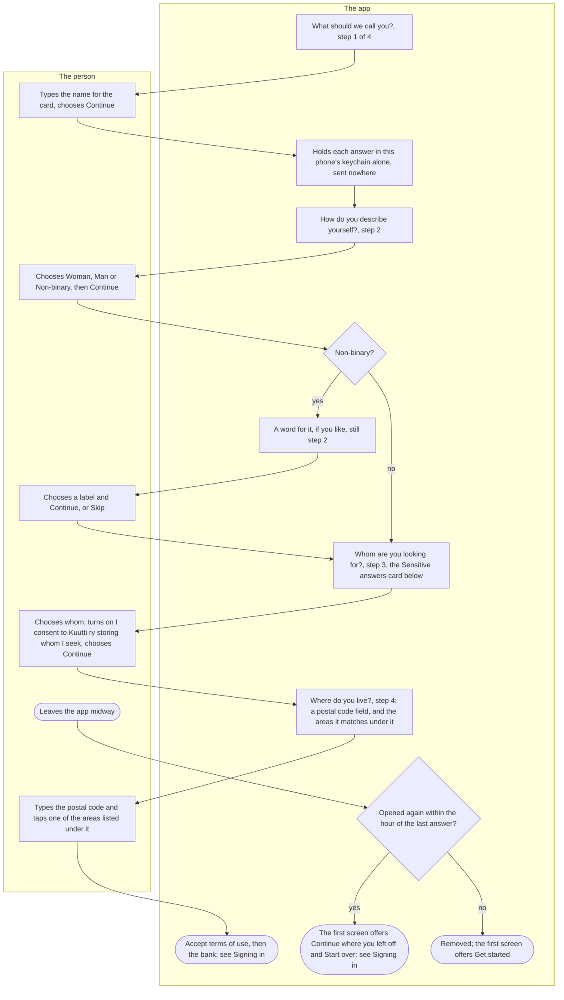
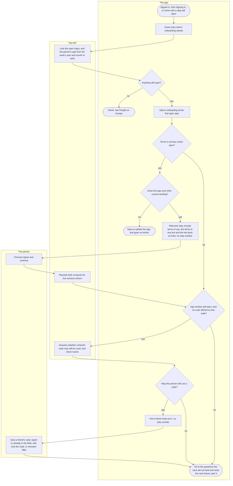
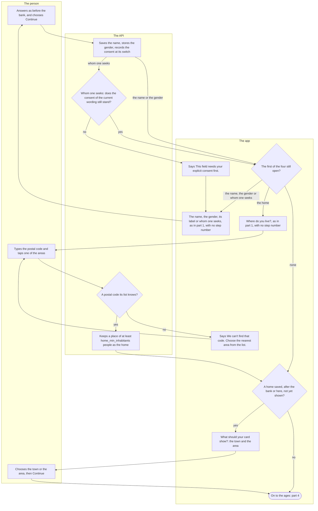
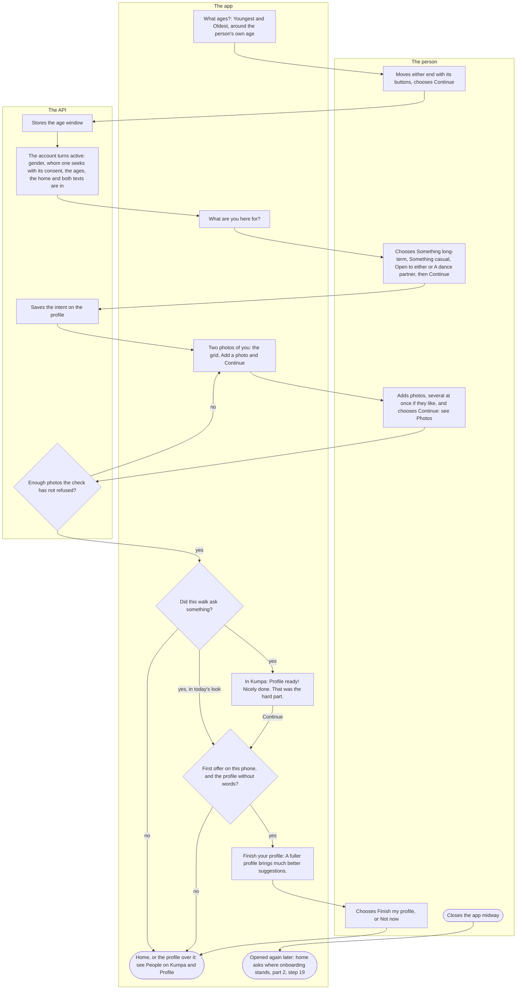

# Onboarding

<!-- draws
apps/mobile/app/onboarding.tsx
apps/mobile/src/features/identity/FirstQuestions.tsx
apps/mobile/src/features/identity/held-answers.ts
apps/mobile/src/features/identity/TermsOfUse.tsx
apps/mobile/src/features/identity/onboarding/OnboardingScreen.tsx
apps/mobile/src/features/identity/onboarding/save-held.ts
apps/mobile/src/features/identity/onboarding/ProfileOffer.tsx
apps/mobile/src/features/identity/onboarding/ProfileReady.tsx
apps/mobile/src/features/identity/onboarding/useOnboarding.ts
apps/mobile/src/features/identity/onboarding/useOnboardingGate.ts
apps/mobile/src/features/rewards/InvitationStep.tsx
apps/mobile/src/features/rewards/RedeemInvitation.tsx
apps/mobile/src/features/profile/PlaceEditor.tsx
apps/mobile/src/features/media/PhotosScreen.tsx
apps/api/src/identity/onboarding-routes.ts
apps/api/src/identity/onboarding.ts
apps/api/src/matching/routes.ts
apps/api/src/matching/preferences.ts
apps/api/src/pond/routes.ts
apps/api/src/pond/home.ts
apps/api/src/rewards/invitations.ts
packages/schema/src/onboarding.ts
packages/schema/src/profile.ts
-->

What a person answers before Kumpa can show them to anyone: before the bank, the name for their card, their gender, whom they seek and their home, held on the phone; after it, the ages, what they are here for and photos, one question per screen, and then, once, the offer of a few words. Everyone with a new account goes through it, and a person whose terms changed, or who took back the consent for whom they seek, comes back to the part that is open again.

## Part 1: before the bank, the four questions held on the phone

### Steps

1. The person chose "Get started" on the first screen of [Signing in](sign-in.md) (steps 2 and 3), and nobody has signed in yet. "What should we call you?", with "Name on your card" over the field, which is never filled in from the bank. "Step 1 of 4" stands over each of the four questions, with "Back" beside it to the question before, and from the first one to the first screen.
2. The person types a name and chooses "Continue", which opens once the field has something in it.
3. Each answer is held as it is given, in this phone's keychain or keystore alone: readable while the phone is unlocked, never in a backup or on another phone, and never sent, logged or reported before the bank login saves it. The answers given so far are kept for an hour after the last one, each answer moving the hour on. The sensitive-answers consent is never kept there: the app holds it in memory, for whoever is at the phone.
4. "How do you describe yourself?": "Yours to choose, not the bank's. This is shown on your card." Woman, Man or Non-binary. "Step 2 of 4".
5. The person chooses one and "Continue".
6. Non-binary: 7. Otherwise: 9.
7. "A word for it, if you like": "Shown on your card, never used for matching." The labels as rows the width of the screen. Still step 2.
8. The person chooses a label and "Continue", which opens once one is chosen, or "Skip", which holds none. A gender changed away from non-binary drops the label held with it.
9. "Whom are you looking for?": "Nobody outside your choice is ever shown to you, and you are never shown to anyone who did not pick you." Women, Men, Non-binary people, or Anyone. Below, the "Sensitive answers" card: its summary, which says that whom one seeks is used for matching and for statistics shown in the app in which no person can be identified, and is not shown to other users; its version as a link to the full text; in Finnish the line that the English text counts; and the switch "I consent to Kuutti ry storing whom I seek". "Step 3 of 4".
10. The person chooses one or more, turns the switch on, and chooses "Continue", which opens only with both. The app holds whom they seek on the phone, and the consent's version and the language it was read in in memory alone; nothing is recorded yet. Turning the switch off takes the consent back.
11. "Where do you live?": "Your postal code tells Kumpa how far people are. Others see a town or your area by name, never the digits." A field, "Postal code", which never opens the keyboard by itself, and under it the areas whose codes start with the digits typed, from the phone's own list, each a button with its code and its name. Digits that no code starts with are said at once, "We can't find that code. Choose the nearest area from the list.", with the nearest areas to choose from. "Step 4 of 4".
12. The person types the postal code and taps their area, which holds its five digits.
13. "Accept terms of use", then the bank: [Signing in](sign-in.md), step 6. Nothing of the four is on the account until the bank login saves it, right after the exchange (Signing in, step 17): what the account already has is kept, and what the save could not land is asked again after the bank (part 3).
14. The person leaves the app, or closes it, before the bank.
15. Opened again within the hour of the last answer: 16. Later: 17.
16. The first screen offers "Continue where you left off", which opens the first question not yet answered, or the terms when all four are, and "Start over", which removes the answers and the acceptances and opens the first question. The consent went when the app left the screen, unless a bank attempt carried it: whom one seeks opens again with its choice made and the switch off.
17. The answers are removed as they are read, and the first screen offers "Get started" as on the first day.

## Part 2: after the bank: arriving, the terms and a friend's code

### Steps

18. The person has just signed in with their bank, which saved what they answered before it (see [Signing in](sign-in.md), step 17), or home has come to the front while a step of onboarding is open: a wording of the terms, the privacy notice or the sensitive-answers consent changed, the person turned off "Store my sensitive answers" in Settings, which takes whom they seek with it, or the place kept as their home is one the list of places no longer knows. The profile's What you seek sends a person back here the same way when its consent is gone (see [Profile](profile.md)).
19. Home asks the API where onboarding stands, every time it comes to the front. Until the answer is there it says "Loading…" and shows nothing that needs a finished account; an answer it cannot read keeps it closed, says why, and offers Try again.
20. The API lists the steps still open, in the order the app asks them, and the person's age from the bank's year and month of birth.
21. Nothing open: 22. Something open: 23. A new account always has something open: the ages at least.
22. Home: see [People on Kumpa](people-on-kuutti.md).
23. The app opens onboarding at the first open step, each step under its question as its one heading, and no step after the bank numbered. After every answer it asks the API again and shows the next open step; a step already answered is passed over, so a walk left midway goes on where it stopped (step 68). A step the API does not take says why in its own words where it has them, else "Something did not load. Try again." Nothing under onboarding is a screen to go back to.
24. The terms or the privacy notice missing for their current wording: 25. Otherwise: 30.
25. Does this app carry the current version of both texts? No: 26. Yes: 27.
26. "This text has a newer version than the one built into this app. Update the app to continue." There is no button: nothing goes further until the app is updated.
27. The welcome step, the fallback for the acceptance normally given before the bank: the screen of [Signing in](sign-in.md) step 6, "Accept terms of use" with the terms in one line, that accounts which break them may be removed, what Agree and continue accepts, and "Read the Terms of Use" and "Read the Privacy Notice" as links to the full texts at the versions the app carries, without the line about keeping the answers. It comes when a wording changed since the person accepted it, when a second person signs in on a shared phone, when the record after the bank failed, or when the acceptance was lost while the bank was open. A person with a finished profile whose terms changed sees this and nothing else, then home.
28. The person chooses "Agree and continue".
29. The API records the terms and the privacy notice for the versions the app showed, in the language they were shown in; a consent it has already is recorded once. The phone remembers the versions, so its next sign-in skips the terms before the bank.
30. The age window still open, as on every first walk, and no friend's code offered on this walk: 31. Otherwise: 35.
31. The API answers whether this person may still use a friend's invitation code: only while their profile is not complete, they never had an account deleted, they have used no code, and they have the current terms and privacy notice. It also answers what a code earns, which `invitation_reward` sets.
32. Yes: 33. No, or the answer could not be read: 35, and Settings offers the code later while it may still be used.
33. "Did a friend invite you?", with no step number. While `invitation_reward` gives the person typing a code a fish, a line says what the code earns them, and their friend when the friend earns too, once their profile is complete. Under it the field "Invitation code", "Use the code" and "Skip". A code that came to the phone by a friend's link, or on an Android phone with the install, is already in the field, unless the person typed first ([Inviting a friend](invitations.md), steps 21 and 25).
34. The person types the code, or leaves the one already in the field, and chooses "Use the code": a code that works says "The code is in." with "Continue", and one that does not is said in words. Or they choose "Skip". Either way the code is done with for this walk: see [Inviting a friend](invitations.md).
35. On to part 3, from step 36.

## Part 3: after the bank: a question the save did not land, and what the card shows

### Steps

36. Which of the four questions of part 1 is the first still open after the bank? One is when the answers were lost with the hour or with the phone, a save failed or the API refused one, a wording of the sensitive-answers consent changed, the consent was withdrawn, or the home's place is one the list no longer knows. The name, the gender or whom one seeks: 37. The home: 42. None: 47.
37. Onboarding asks it in part 1's words, under its question and with no step number. On whom one seeks the switch stays on once turned on; when the app carries an older wording of the consent than the API, the card says "This text has a newer version than the one built into this app. Update the app to continue." in place of the switch, and the step cannot be passed; after a new wording, the choice starts from the answer stored before.
38. The person answers as before the bank and chooses "Continue", which stores the answer at once; after non-binary the label is offered once, saved with Continue or not with Skip.
39. The name is saved on the profile; the gender is stored as declared, nothing from the bank informing it, and onboarding asks it only while none is stored, so the wait of `change_cadence_days` between two changes of gender never applies here (a later change is the profile's: see [Profile](profile.md)). On whom one seeks the API records the sensitive-answers consent as soon as the switch is turned on. The name or the gender: 36. Whom one seeks: 40.
40. Does the consent of the current wording still stand, read under the same lock a withdrawal takes? Yes: the API stores whom the person seeks, a filter that holds both ways, as often as the person likes, with no wait, and 36. No, as when it was withdrawn on another phone while the step was open: 41. Withdrawing the consent is in Settings, "Store my sensitive answers": it takes whom the person seeks with it, so this step is asked again, while the age window stays.
41. "This field needs your explicit consent first.", nothing is stored, and the app reads the open steps again, so the switch can be turned on again: 37.
42. "Where do you live?" in part 1's words, with no step number.
43. The person types the postal code and taps their area. A phone with an older list can still offer one the API no longer has.
44. Does the API's list know the code? No: 45. Yes: 46.
45. "We can't find that code. Choose the nearest area from the list.", and nothing is kept: 43.
46. The API keeps as the home a place of at least `home_min_inhabitants` people: the postal area if it has that many, else its municipality, else the nearest municipality that has them. The digits of an area too small to keep are looked up and gone, and the answer names places, never digits. The home can be changed later in the profile: see [Profile](profile.md).
47. Has a home just been saved, by the save after the bank or at step 46, and not yet shown? Yes: 48. No: 50.
48. "What should your card show?", with the town and the area as rows the width of the screen, the town chosen, and "Continue". The town is the kept place's own municipality when it has at least `home_town_min_inhabitants` people, else the nearest one that has. Where the place keeps no area, or the area bears the town's name, the heading says "On your card:" and the place, with "Continue" alone. It is offered once, on this walk: the profile still offers the area later.
49. The person chooses the town or the area, which is saved at once, and "Continue".
50. On to part 4, from step 51.

## Part 4: after the bank: the ages, the intent, photos and the offer

### Steps

51. "What ages?", with the lowest and highest ages Kumpa allows. Two steppers, "Youngest" and "Oldest", one above the other, start a few years either side of the person's own age, inside those bounds. The step is asked only while no window is stored.
52. The person moves either end with its buttons ("Youngest, one year older", "Oldest, one year younger" and their pairs): the youngest never passes the oldest and neither leaves the bounds. Then "Continue".
53. The API stores the age window, a filter that holds both ways.
54. On the first read that finds them all, for a newcomer the read after the ages, the API turns the account active: the gender, whom one seeks with its consent, the age window, the home, and the terms and the privacy notice in their current wording. Nothing on the screen changes, and home still sends the person back while anything is open; matching opens for a person only once nothing is open, their photos are approved and an admin has opened it: see [People on Kumpa](people-on-kuutti.md).
55. "What are you here for?": "You're shown only to people who want the same thing."
56. The person chooses "Something long-term", "Something casual", "Open to either" or "A dance partner", each a row the width of the screen, and "Continue". Open to either covers long-term and casual; a dance partner meets dance partners only.
57. The API saves the intent on the profile.
58. The photos step is the photos screen itself: "Two photos of you", "Profiles with a face photo get seen.", the grid of photos, "Add a photo" and "Continue", its only way on.
59. The person adds photos from the phone, several at once if they like, as on the photos screen of the profile (see [Photos](photos.md)), and chooses "Continue", which opens once enough photos count as the API counts them: one waiting for the check or for a moderator counts, a refused one does not. How many is under Open below.
60. Continue reads the photos and the open steps again: does the person have enough photos the check has not refused? A photo refused meanwhile keeps the step, and its tile says why. Yes: 61. No: 58. The card and matching wait for the photos' approval. A bio, a ready line or prompts are no step: a profile is complete without them.
61. Nothing is open now. Did this walk ask something? Yes: 62. No, the person came here with nothing missing: 66.
62. In Kumpa, the look every phone starts in, and in every style of the tech screen but today's: "Profile ready!", "Nicely done. That was the hard part.", the person's own first photo among drawn shapes, and "Continue", the one way on: 63. It promises nothing about who will see the profile or when, which home's matching card says. With reduce motion on it stands as it ends. In today's look, chosen on the tech screen outside production, nothing shows here: 63 at once.
63. Has this phone never shown the offer, and has the profile no words, neither a bio of the length the code holds, a ready line, nor two answered prompts? Yes: 64. No: 66.
64. "Finish your profile": "A fuller profile brings much better suggestions. Add a few words about yourself or answer a few questions, or go on as you are." It is marked as shown as it shows, and never comes back on this phone: there is no reminder.
65. The person chooses "Finish my profile" or "Not now".
66. "Finish my profile" opens the profile, with home under it; "Not now", or no offer, goes home, with nothing between: see [People on Kumpa](people-on-kuutti.md). The optional questions and the rest of the profile wait there: see [Profile](profile.md).
67. The person closes the app, or leaves it, midway.
68. When they open it again, home asks where onboarding stands (step 19) and onboarding opens at the first open step; nothing answered is asked again. Each answer after the bank was stored with its Continue, the sensitive-answers consent with its switch, the home with its tap. What lived only on the screen is gone: a choice not yet continued, the steppers (they start around the person's age again), the label's offer after non-binary (not offered again here), the choice of what the card shows of the home (the town stays, and the profile still offers the area), and a friend's code typed and not used (the step is offered again only while the age window is still open; a code that came by a link stays on the phone, for this step or for Settings).

## Open

- How many photos close the photos step (steps 59 and 60). The code asks for two that the check has not refused ([profile.ts](../../packages/schema/src/profile.ts), read in [onboarding.ts](../../apps/api/src/identity/onboarding.ts) and in [PhotosScreen.tsx](../../apps/mobile/src/features/media/PhotosScreen.tsx)), the step's title is "Two photos of you", [ADR-009](../adr/009-profile-and-card.md) §4 has said two since 2026-10-05 (#56), and ADR-010's History of 2026-11-04 speaks of two. [ADR-010](../adr/010-onboarding-and-consents.md) §10 still says three photos, and so do the spec's scenario in [onboarding.feature](../../features/identity/onboarding.feature) and the opening comment of the Maestro flow [onboarding.yaml](../../apps/mobile/e2e/flows/onboarding.yaml); the scenario and the flow add three and pass either way. The register notes it under [Found on the way](../decisions.md#found-on-the-way).

## Where it lives

- Screens: [onboarding.tsx](../../apps/mobile/app/onboarding.tsx); in the identity feature [OnboardingScreen.tsx](../../apps/mobile/src/features/identity/onboarding/OnboardingScreen.tsx) (the steps and their order), [ProfileReady.tsx](../../apps/mobile/src/features/identity/onboarding/ProfileReady.tsx) (Profile ready!, in every look but today's), [useOnboarding.ts](../../apps/mobile/src/features/identity/onboarding/useOnboarding.ts), [useOnboardingGate.ts](../../apps/mobile/src/features/identity/onboarding/useOnboardingGate.ts) (home sends an unfinished account here), [client.ts](../../apps/mobile/src/features/identity/onboarding/client.ts), the welcome step's [TermsOfUse.tsx](../../apps/mobile/src/features/identity/TermsOfUse.tsx) and [agreements.ts](../../apps/mobile/src/features/identity/agreements.ts); the questions before the bank in [FirstQuestions.tsx](../../apps/mobile/src/features/identity/FirstQuestions.tsx), held by [held-answers.ts](../../apps/mobile/src/features/identity/held-answers.ts) and saved after the bank by [save-held.ts](../../apps/mobile/src/features/identity/onboarding/save-held.ts); the offer's [ProfileOffer.tsx](../../apps/mobile/src/features/identity/onboarding/ProfileOffer.tsx); the code step's [InvitationStep.tsx](../../apps/mobile/src/features/rewards/InvitationStep.tsx) and [RedeemInvitation.tsx](../../apps/mobile/src/features/rewards/RedeemInvitation.tsx); the home's [PlaceEditor.tsx](../../apps/mobile/src/features/profile/PlaceEditor.tsx); the photos step [PhotosScreen.tsx](../../apps/mobile/src/features/media/PhotosScreen.tsx)
- API: `GET /onboarding`, `PUT /account/gender` and `POST /consents` in the identity slice's [onboarding-routes.ts](../../apps/api/src/identity/onboarding-routes.ts), with [onboarding.ts](../../apps/api/src/identity/onboarding.ts) (the open steps, activation); `PUT /preferences` in the matching slice's [routes.ts](../../apps/api/src/matching/routes.ts), with [preferences.ts](../../apps/api/src/matching/preferences.ts) (whom one seeks with its consent, the ages); `PUT /account/home` in the pond slice's [routes.ts](../../apps/api/src/pond/routes.ts), with [home.ts](../../apps/api/src/pond/home.ts) and [places.ts](../../apps/api/src/pond/places.ts) (the place kept, the town); `PUT /profile` in the profile slice's [routes.ts](../../apps/api/src/profile/routes.ts); `GET /invitations` and `POST /invitations/redeem` in the rewards slice's [routes.ts](../../apps/api/src/rewards/routes.ts) with [invitations.ts](../../apps/api/src/rewards/invitations.ts); the steps, activation's six and the age bounds in [packages/schema/src/onboarding.ts](../../packages/schema/src/onboarding.ts), the photos a finished profile needs, and the words the offer looks for, in [packages/schema/src/profile.ts](../../packages/schema/src/profile.ts)
- Spec: [onboarding.feature](../../features/identity/onboarding.feature), [preferences.feature](../../features/matching/preferences.feature), [home.feature](../../features/pond/home.feature)
- Maestro: [onboarding.yaml](../../apps/mobile/e2e/flows/onboarding.yaml) (the whole walk, the questions before the bank in three languages, closed and resumed), [age-window-bounds.yaml](../../apps/mobile/e2e/flows/age-window-bounds.yaml), [identity-label-on-card.yaml](../../apps/mobile/e2e/flows/identity-label-on-card.yaml), [terms-asked-again.yaml](../../apps/mobile/e2e/flows/terms-asked-again.yaml), [sensitive-answers-withdrawal.yaml](../../apps/mobile/e2e/flows/sensitive-answers-withdrawal.yaml); the shared step [welcome-step.yaml](../../apps/mobile/e2e/common/welcome-step.yaml)
- ADRs: [ADR-010](../adr/010-onboarding-and-consents.md) §4 (a consent bound to its version), §6 (activation), §10 (the field sheet's steps), §13 (whom one seeks saved on its own), §15 (the consents before the bank, the welcome step as the fallback), §16 (whom one seeks refused without the consent), §22 (the questions before the bank held on the phone, their save, the words a one-time offer); [ADR-019](../adr/019-profile-fields-and-roles.md) §1 (the label) and §4 (the sensitive-answers consent); [ADR-060](../adr/060-no-waiting-at-the-pond.md) §9 (no wait on whom one seeks, gender's stays); [ADR-061](../adr/061-one-home-no-ponds.md) §1 to §4 (the home, the place kept, what the card shows, the list of places); [ADR-044](../adr/044-invitations.md) §6 and §12 and [ADR-074](../adr/074-the-links-the-app-takes.md) §4 (a friend's code, and one that came by a link); [ADR-009](../adr/009-profile-and-card.md) §4 (what a finished profile needs, no words since #681)
- Rules: the register's [Sign-in and identity](../decisions.md#sign-in-and-identity), [Profile](../decisions.md#profile), [Filters](../decisions.md#filters) and [Invitations and rewards](../decisions.md#invitations-and-rewards) rows

## History

- 2026-09-26 (#46, PR #65): onboarding: both consents for the version read, the gender, whom one seeks with the age window, the area, and the research question; home sends anybody unfinished back to it, and the account turns active once the answers are there.
- 2026-10-08 (#146, PR #154): the field sheet's order, one question per screen: the welcome with the norms, the name, the gender and after non-binary a label, whom one seeks with the sensitive-answers consent on the same screen, the intent, the ages as two steppers, photos and a few words; the one area is assigned without a step.
- 2026-10-09 (#147, PR #155): a change of whom one seeks from an earlier answer waits `change_cadence_days`, and the step says from which day.
- 2026-10-10 (#146, PR #169): the photos screen has Done, the way back to onboarding.
- 2026-10-10 (#174, PR #212): a second area: "Where do you live?" after the ages, one button per area, named in the person's language.
- 2026-10-10 (#204, PR #214): after the sensitive-answers consent is withdrawn, only whom one seeks is asked again; the age window stays.
- 2026-10-10 (#146, PR #219): whom one seeks is saved on leaving its screen, so closing the app before the ages keeps it.
- 2026-10-13 (#239, PR #271): a ready line counts as a few words.
- 2026-10-14 (#175, PR #284): "A dance partner" joins the intents.
- 2026-10-14 (#223, PR #286): "Save and continue" on the words waits until they count, and a refused save says why.
- 2026-10-17 (#208, PR #343): each legal text on the welcome step and on whom one seeks shows its version as a link to the full text.
- 2026-10-22 (#107, PR #417): a friend's invitation code, offered once before the name, with Skip.
- 2026-10-22 (#418, PR #422): the consents move before the bank login, the welcome step becomes the fallback with no step number, the research step goes, and the steps are counted as eight from the name.
- 2026-10-31 (PR #554): whom one seeks is refused without the sensitive-answers consent of the current wording, as when it was withdrawn on another phone while the step was open, and the step says so.
- 2026-10-31 (#500, PR #555): a change of whom one seeks no longer waits; the wait of `change_cadence_days` stays on the gender alone.
- 2026-11-01 (#514, PR #556): the home postal code after the ages, in the area's place: a place of at least `home_min_inhabitants` people is kept, the person chooses whether the card shows its town or its area, and the account turns active with a home.
- 2026-11-01 (#542, PR #561): after a new wording of the consent, whom one seeks starts from the answer stored before and the step stays until Continue; whom one seeks, the ages and the gender can be changed later in the profile.
- 2026-11-05 (#581, PR #597): each step's question is its one heading and "Welcome to Kuutti" goes; the intents are rows the width of the screen; the photos step is the photos screen itself, ended by its own Continue, where Add photos and Done went; "All set." goes and home follows.
- 2026-11-16 (#208): the welcome step and the sensitive answers carry the texts in force, version 2026-11-1, and everybody is asked again; the line about the text that counts is shown in Finnish alone and says that the English text is the one.
- 2026-11-16 (#700, PR #701): the home step names the app Kumpa, and the consent to store whom one seeks is given to Kuutti ry.
- 2026-11-16 (#208): research leaves the app, consent and all; onboarding already asked nothing about it.
- 2026-11-17 (#184, PR #723): a friend's code that came by their link, or with an Android install, is already in the code's field.
- 2026-11-18 (#681): the photos step picks several photos at once, as the photos screen does.
- 2026-11-19 (#681): turned round: the name, the gender and its label, whom one seeks with the sensitive-answers consent, and the home are asked before the bank, counted as four, held on the phone for an hour, the consent in memory for whoever is at the phone, and saved by the bank login once the account holds the terms; after it come a friend's code, what the card shows of the home, the ages, the intent and the photos, with no step number, and a question the save did not land; the welcome step is the terms in one line and two links; a few words are no step, and a walk ends on one offer to finish the profile, once on a phone.
- 2026-11-20 (#411): in Kumpa, the look every phone starts in, a walk that asked something ends on "Profile ready!" before the offer to finish the profile or home; today's look, on the tech screen, goes straight on.
