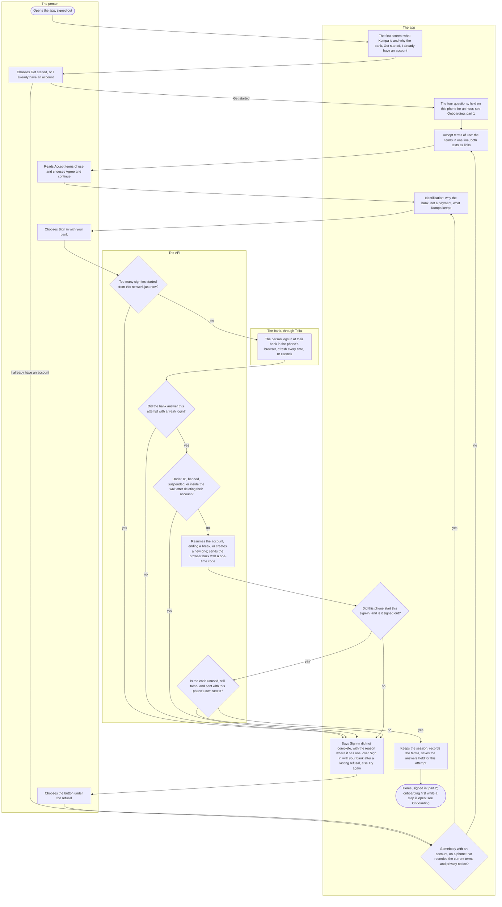
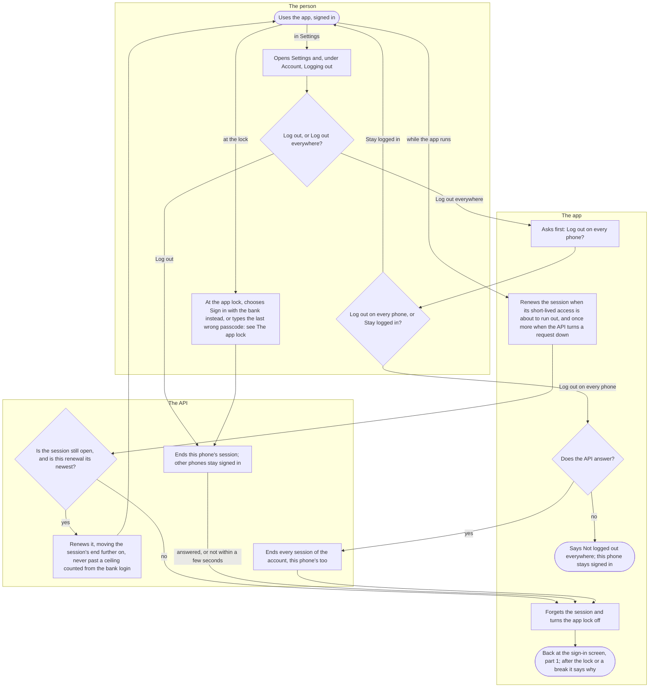

# Signing in

<!-- draws
apps/mobile/app/index.tsx
apps/mobile/app/auth.tsx
apps/mobile/app/+native-intent.ts
apps/mobile/src/features/home/HomeRoute.tsx
apps/mobile/src/features/home/HomeScreen.tsx
apps/mobile/src/features/identity/SignInScreen.tsx
apps/mobile/src/features/identity/Intro.tsx
apps/mobile/src/features/identity/TermsOfUse.tsx
apps/mobile/src/features/identity/held-answers.ts
apps/mobile/src/features/identity/onboarding/save-held.ts
apps/mobile/src/features/identity/agreements.ts
apps/mobile/src/features/identity/verifier.ts
apps/mobile/src/features/identity/return-link.ts
apps/mobile/src/features/identity/session.tsx
apps/mobile/src/features/identity/SignedOutToStart.tsx
apps/mobile/src/features/identity/onboarding/useOnboardingGate.ts
apps/mobile/src/features/settings/SettingsScreen.tsx
apps/mobile/src/features/settings/DeviceActions.tsx
apps/api/src/identity/routes.ts
apps/api/src/identity/login.ts
apps/api/src/identity/links.ts
apps/api/src/identity/registration.ts
apps/api/src/identity/codes.ts
apps/api/src/identity/sessions.ts
apps/api/src/identity/onboarding-routes.ts
-->

How a person gets into Kumpa and out again: the first screen, the questions and the terms before the bank, the bank login itself, who the bank login lets in and who not, and how a session on a phone ends. Everyone who uses the app goes through it, at their first sign-in and on every new phone.

## Part 1: signing in

### Steps

1. The person opens the app with no session on this phone. While the app reads whether it holds one, the screen says "Loading…".
2. The first screen says what Kumpa is and why it asks for a bank ID: "A more confident start to dating", "Kumpa is a dating community of people whose real-world identities have been verified.", "Verify your identity with a Finnish bank ID.", "Free dating for adults in Finland. Run by a registered association." and "Your answers stay on this phone until you make an account." There is no legal text on it. Its buttons are "Get started" and "I already have an account"; while answers given within the last hour wait on the phone (see [Onboarding](onboarding.md), part 1), "Continue where you left off" and "Start over" stand in the first one's place, and Start over removes them.
3. "Get started", or "Continue where you left off": 4. "I already have an account": 5.
4. The four questions, the name for the card, the gender and its label, whom one seeks with the sensitive-answers consent, and the home postal code, counted "Step x of 4", each held on this phone for an hour after the last answer and sent nowhere: see [Onboarding](onboarding.md), part 1. Continue where you left off opens the first not yet answered, or the terms when all four are. Then 6, every time: a newcomer always accepts the terms for the attempt that will save their answers.
5. Is this somebody with an account, on a phone that has recorded the versions of the terms and the privacy notice that this build carries, at an earlier sign-in or on onboarding's welcome step, or who accepted them on this screen a moment ago? Yes: 8. No: 6. A new phone, or an update that changed a wording, shows the terms again. After a refusal (step 20), somebody whose answers wait for this attempt is a newcomer: 6.
6. "Accept terms of use": for a newcomer, "To keep your answers, make an account: accept the terms and identify with your bank."; then the terms in one line, "Be respectful. Use photos of yourself. Don't copy or collect other members' photos or profiles.", "We may remove accounts that break these rules.", "By tapping Agree and continue, you accept our Terms of Use and our Privacy Notice.", and "Read the Terms of Use" and "Read the Privacy Notice", each a link to the full text at the version this build carries. "Back" goes to the last question, or for somebody with an account to the first screen. The bank cannot be reached before it.
7. The person chooses "Agree and continue". There is no account yet, so the app holds the acceptance in memory and sends nothing. It belongs to the next bank attempt only: leaving the app before the bank opens, a refusal, a second attempt, or the attempt's time running out drops it, and whoever signs in next accepts again. The answers held for the four questions stay on the phone, within their hour.
8. "Identification": "Use your Finnish bank ID to confirm your identity and age.", "This is an identity check, not a payment.", "Kumpa does not keep your name or your identity code from the bank. Others see the name you choose.", and the button "Sign in with your bank". "Back" goes to the terms, or for somebody with an account to the first screen; Android's back button steps back the same way, and leaves the app from the first screen.
9. The person chooses "Sign in with your bank". The app opens the API in the phone's own browser, never inside the app, with the fingerprint of a secret it keeps for this attempt and the app's language for the bank's chooser. A newcomer's held answers are tied to this attempt: only its exchange saves them.
10. The API counts the sign-ins started from this network just now. Too many: 19, "Too many sign-ins were started just now. Wait a minute and try again." The same refusal comes, rarely, when so many sign-ins are under way across Kumpa that none can make room; before that, the oldest attempts the bank has not answered end to make it. Otherwise the API remembers the attempt and sends the browser on to Telia's bank chooser: 11.
11. The person chooses their bank and logs in there. Kumpa asks for the bank every time, so a bank login left open in the browser, perhaps by somebody else, is never reused. Or the person cancels at the bank.
12. The bank's answer comes back to the API, which answers each attempt once. Cancelled: 19, "Nothing was saved." An attempt the API does not know, has answered already or has seen expire, a failure of the bank's service, or a bank login older than this attempt: 19, with the card's title alone. Otherwise: 13. From the personal identity code the API takes the year and month of birth and a code that cannot be turned back into the person, and keeps nothing else of it.
13. Under 18: 19, "Kumpa is for adults. You are welcome once you are 18." Nothing is stored. Otherwise the API looks the person up by that code. Banned: 19, "This person may not use Kumpa." Suspended: 19, "This account is suspended. You can sign in again from:" and the day, or "This account is suspended for now." when there is no end day. A ban's and a suspension's refusal also carries the reason of the newest one open, a value of the closed list. Deleted their own account and still inside the wait before a new one: 19, "You deleted your account recently. The earliest day for a new one:" and the day. Each of these refusals is counted on the person. Otherwise: 14.
14. A person with an account resumes it, and an account on a break comes off the break. A person the bank has never brought here, or whose last account was deleted longer ago than the wait, gets a new account with nothing restored. The browser goes back to the app with a one-time code. Where the phone has checked that links at the API's address are Kumpa's, the code comes in such a link, which the phone hands to Kumpa alone; otherwise, and on a build from before these links, it comes in the app's own kind of link, which another app could ask for too. A browser that opens the first kind by itself is sent on to the second.
15. The app takes the code only if this phone started a sign-in a short while ago and is not signed in. A link this phone did not ask for, of either kind, such as a code somebody else sent as a link, is refused and the session is left as it was: 19, "This sign-in link was not requested from this phone." Otherwise: 16, while the screen says "Signing you in…".
16. On an iPhone the app first asks Apple to certify that it is the real app on a real phone, waiting ten seconds at most, and sends Apple's answer with the code. An iPhone whose build is from before #184's native batch, one Apple gives no answer, and every other phone send the code alone. The API takes the code once, while it is fresh, and only with the secret this phone kept for the attempt, so a code another app read off the link is worth nothing. Used, expired, unknown or not this phone's: 19, with the card's title alone. Apple's answer missing where the API asks for it, which it does nowhere yet, or not holding: 19, "Apple could not confirm the app on this iPhone." Too many requests from this network: 19, as in step 10. Otherwise the API opens a session for this phone, a short-lived access and a renewal that only this phone holds: 17.
17. The app keeps the session in the phone's secure store, which is never backed up or moved to another phone. If the person accepted step 7 for this attempt, the app records the terms, then the privacy notice, before anything else; once both are recorded, the phone remembers their versions, so its next sign-in for somebody with an account skips the terms (step 5). Then, once the account holds the terms and the privacy notice in force, the answers held for this attempt are saved through the account's own routes, each only where the account has none: the name and the label, the gender, the sensitive-answers consent and then whom one seeks, and the home; a save that fails is asked again in onboarding (see [Onboarding](onboarding.md), part 3), and the answers are removed from the phone as they are taken. A record of the terms that fails is asked again on onboarding's welcome step. "Signing you in…" stands until the next screen takes over.
18. The app goes home, which asks the API where onboarding stands, saying "Loading…" meanwhile. Finished: home, signed in: part 2; after the sign-in that ended a break, it says once: "Welcome back. Your profile is visible again." Not finished, as a new account never is: onboarding opens at its first open step: see [Onboarding](onboarding.md). It opens on the welcome step, which asks the terms again, when the terms or the privacy notice are missing: a wording changed after the phone recorded it, a second person signing in on a shared phone, a record that failed, or an acceptance lost when Android ended the app while the bank was open.
19. The sign-in screen says "Sign-in did not complete". A refusal with a fact of its own says it under the title, in the words given at each step; a link gone stale or a failure on the way has the title alone. Under a ban's or a suspension's sentence it says why and how to contest it, as every sanction does: "Why:" and the reason, the section of the terms it rests on, "A moderator decided this." and "If you think we got this wrong, write to hello@kumpa.fi. Someone other than the person who decided will look at it again." A reason that is not one of the list, as in a link somebody made up, adds nothing. The acceptance held for this attempt is dropped. The button under it says "Sign in with your bank" after a refusal that rests on the person (under 18, banned, suspended, or inside the wait after a deletion), since another try only repeats it, and "Try again" after any other. A refusal that rests on the person also removes the answers held on the phone; a cancellation, or any other refusal, keeps them for the next try, within their hour.
20. The person chooses the button: 5. Either button opens the bank again, but on a phone that has not recorded the terms and the privacy notice, or for a newcomer whose answers wait, it shows the terms first, never the bank straight away.

## Part 2: sessions and logging out

### Steps

21. The person uses the app, signed in on this phone. Closing and reopening the app keeps the session: there is no bank login at every start.
22. Before a request, when the session's short-lived access is about to run out, the app renews the session, and once more whenever the API turns a request down: that one renewal decides whether the session is over. A renewal that fails for another reason, the API unwell or no network, keeps the session for the next try. A session that began with Apple's answer is renewed with a signature of the same phone's key, which no copy of the session elsewhere can make.
23. Is the session still open, and is this renewal its newest? Yes: 24. No: 34, and every such renewal is answered the same. A session is over after Log out everywhere on another phone, a ban or a suspension, a break taken on another phone, the account deleted, the phone left unused until the session's end, or the ceiling counted from the bank login, however often the phone is used. Any earlier renewal of the session presented again, however many renewals back it is, is taken for a copy: the API ends the session for every phone that holds it.
24. The API renews the session and moves its end further on, never past that ceiling, so a phone in use stays signed in and nothing shows: 21.
25. The person opens "Settings", the gear on home, and under "Account" the row "Logging out", which opens in place: "Log out", and "Log out everywhere" with "For a lost or lent phone."
26. "Log out": 28. "Log out everywhere", the way back from a lost phone: 29.
27. At the app lock the person chooses "Sign in with the bank instead", or types the last wrong passcode: see [The app lock](app-lock.md). It signs this phone out as Log out does: 28.
28. The API ends this phone's session, and the person's other phones stay signed in. The app waits a few seconds at most and signs the phone out whatever the answer; when the API did not take the logout, the phone also drops its token for notifications, so that nothing is pushed to it for a session the API may still hold: 34.
29. The app asks first: "Log out on every phone?", "Every phone, this one too, needs your bank to log in again."
30. "Stay logged in": 21, and nothing changes. "Log out on every phone": 31.
31. The app asks the API to end every session. No answer, or a failure at the API: 32. An answer that every session is ended, or that this one was over already: 33.
32. "Not logged out everywhere. Check your connection and try again." This phone stays signed in.
33. The API ends every session of the account, this phone's too. Each other phone finds out at its next request (step 23).
34. The app forgets the session on this phone, and the app lock with it: any sign-out turns the lock off.
35. The app goes back to the sign-in screen, step 1, from whatever screen was open. Right after the lock signed this phone out it says "Signed out by the lock" and "Nothing on your account changed. The lock is off until you turn it on again in Settings."; right after a break began on this phone, "Your account is on a break". Reopening the app does not bring the session back.

## Where it lives

- Screens: [index.tsx](../../apps/mobile/app/index.tsx) (the sign-in when signed out, home when signed in), [auth.tsx](../../apps/mobile/app/auth.tsx) (the return from the bank), reached by either link through [+native-intent.ts](../../apps/mobile/app/+native-intent.ts) and [return-link.ts](../../apps/mobile/src/features/identity/return-link.ts); [HomeRoute.tsx](../../apps/mobile/src/features/home/HomeRoute.tsx), [HomeScreen.tsx](../../apps/mobile/src/features/home/HomeScreen.tsx) (Welcome back); in the identity feature [SignInScreen.tsx](../../apps/mobile/src/features/identity/SignInScreen.tsx) (the stages before the bank, the refusals and the button's words), [Intro.tsx](../../apps/mobile/src/features/identity/Intro.tsx) (the first screen), [TermsOfUse.tsx](../../apps/mobile/src/features/identity/TermsOfUse.tsx), [held-answers.ts](../../apps/mobile/src/features/identity/held-answers.ts) (the answers held on the phone, their hour and their attempt), [save-held.ts](../../apps/mobile/src/features/identity/onboarding/save-held.ts) (their save after the exchange), [agreements.ts](../../apps/mobile/src/features/identity/agreements.ts), [verifier.ts](../../apps/mobile/src/features/identity/verifier.ts), [session.tsx](../../apps/mobile/src/features/identity/session.tsx), [SignedOutToStart.tsx](../../apps/mobile/src/features/identity/SignedOutToStart.tsx), [useOnboardingGate.ts](../../apps/mobile/src/features/identity/onboarding/useOnboardingGate.ts); Settings' row Logging out in [SettingsScreen.tsx](../../apps/mobile/src/features/settings/SettingsScreen.tsx) and [DeviceActions.tsx](../../apps/mobile/src/features/settings/DeviceActions.tsx); the stored session and its renewal in [lib/session.ts](../../apps/mobile/src/lib/session.ts) and [lib/api.ts](../../apps/mobile/src/lib/api.ts)
- API: `GET /auth/start`, `GET /auth/callback`, `POST /auth/exchange`, `POST /auth/refresh`, `POST /auth/logout`, `POST /auth/logout-all` in the identity slice's [routes.ts](../../apps/api/src/identity/routes.ts), with [login.ts](../../apps/api/src/identity/login.ts), [registration.ts](../../apps/api/src/identity/registration.ts) (who is let in), [codes.ts](../../apps/api/src/identity/codes.ts) and [sessions.ts](../../apps/api/src/identity/sessions.ts) (the renewal, its end and its ceiling, an earlier renewal presented again); the return's own address, `GET /auth/return`, and the two files that make it Kumpa's on a phone, in [links.ts](../../apps/api/src/identity/links.ts); the session check in [auth-middleware.ts](../../apps/api/src/lib/auth-middleware.ts); the acceptance before the bank through `POST /consents` in [onboarding-routes.ts](../../apps/api/src/identity/onboarding-routes.ts), and the answers held through the routes of [Onboarding](onboarding.md#where-it-lives); the bank's dialect in the kit [`@kuutti-ry/tunnistus-oidc`](https://github.com/kuutti-ry/tunnistus-oidc), its own repository, described in [telia.md](../vendors/telia.md)
- Spec: [bank-login.feature](../../features/identity/bank-login.feature), [re-registration.feature](../../features/identity/re-registration.feature), [sessions.feature](../../features/identity/sessions.feature), and the questions and the terms before the bank in [onboarding.feature](../../features/identity/onboarding.feature)
- Maestro: [sign-in-refusals.yaml](../../apps/mobile/e2e/flows/sign-in-refusals.yaml), [sign-in-links.yaml](../../apps/mobile/e2e/flows/sign-in-links.yaml), [log-out-everywhere.yaml](../../apps/mobile/e2e/flows/log-out-everywhere.yaml), [settings-survive-relaunch.yaml](../../apps/mobile/e2e/flows/settings-survive-relaunch.yaml), [terms-asked-again.yaml](../../apps/mobile/e2e/flows/terms-asked-again.yaml), [onboarding.yaml](../../apps/mobile/e2e/flows/onboarding.yaml) (a newcomer through the questions before the bank); the shared steps [bank-login.yaml](../../apps/mobile/e2e/common/bank-login.yaml), [before-sign-in.yaml](../../apps/mobile/e2e/common/before-sign-in.yaml), [sign-in.yaml](../../apps/mobile/e2e/common/sign-in.yaml) and [sign-out.yaml](../../apps/mobile/e2e/common/sign-out.yaml)
- ADRs: [ADR-010](../adr/010-onboarding-and-consents.md) §15 (the terms before the bank) and §22 (the first screen, the questions held on the phone, their save), [ADR-016](../adr/016-fresh-bank-login.md) (the bank every time), [ADR-017](../adr/017-tunnistus-oidc-package.md) (the bank's dialect), [ADR-022](../adr/022-taking-a-break.md) (a break ends at the next sign-in), [ADR-024](../adr/024-sanctions.md) §4 and §5 (a sanction ends the sessions; the suspension's day), [ADR-073](../adr/073-telling-a-sanction.md) §2 (a ban's and a suspension's reason at the refusal), [ADR-026](../adr/026-limits-per-person-and-sign-in-doors.md) §4 and §6 (too many sign-ins; the oldest attempts making room), [ADR-027](../adr/027-sign-in-code-bound-to-the-device.md) (the code bound to the phone), [ADR-074](../adr/074-the-links-the-app-takes.md) §2 and §3 (the link the code returns in), [ADR-069](../adr/069-an-iphone-proves-it-runs-the-app.md) (Apple's answer at the exchange), [ADR-045](../adr/045-app-lock.md) §2 and §6 (a sign-out turns the lock off; the lock's way out), [ADR-058](../adr/058-sessions-end-after-ninety-idle-days.md) (the session's end and its ceiling), [ADR-059](../adr/059-refresh-token-carries-its-session.md) (an earlier renewal presented again)
- Rules: the register's [Sign-in and identity](../decisions.md#sign-in-and-identity), [Safety](../decisions.md#safety) (a sanction signs every phone out; the suspension's day), [Break and erasure](../decisions.md#break-and-erasure) (the wait after a deletion) and [Limits](../decisions.md#limits) (the sign-in starts) rows

## History

- 2026-09-22 (#33, PR #40): the bank login: under 18 refused, a banned or suspended person and one inside the wait after deleting their account refused, a known person back in their account, a newcomer given one, and a one-time code back to the app.
- 2026-09-23 (#35, PR #42): a session per phone, renewed in the background, ended by logging out or logging out everywhere.
- 2026-09-23 (#36, PR #43): the sign-in screen, the return from the bank into the app, every refusal said in the app, and a return link this phone did not ask for refused.
- 2026-09-23 (#32, PR #45): cancelling at the bank comes back as its own refusal.
- 2026-10-07 (#32, #33, PR #130): the bank is asked every time, and a bank login older than the attempt is refused.
- 2026-10-08 (#143, #36, PR #152): Log out and Log out everywhere move to the Settings screen.
- 2026-10-10 (#146, PR #169): a session that ends while a screen is open takes the app back to the sign-in.
- 2026-10-10 (#35, PR #187): the session stays on the phone that signed in; a phone restored from a backup signs in with the bank.
- 2026-10-13 (#170, PR #277): the sign-in after a break ends it and home says welcome back; the sign-in screen says when a break has begun.
- 2026-10-14 (#287, PR #290): Log out and Log out everywhere move to a screen of their own, Settings › This device.
- 2026-10-16 (#307, PR #315): a suspension's refusal names the day it ends.
- 2026-10-16 (#41, PR #325): too many sign-ins started from one network are refused, with a minute's wait.
- 2026-10-17 (#186, PR #327): the one-time code works only with the secret of the phone that started the sign-in.
- 2026-10-22 (#418, PR #422): the norms, the terms, the privacy summary and the research question move before the bank login, and a phone that recorded them skips them; the sign-in screen says when the app lock signed the phone out.
- 2026-10-28 (#472, PR #489): each renewal moves a session's end further on, never past a ceiling counted from the bank login, so a phone in use stays signed in and one left unused goes to the bank again.
- 2026-10-29 (#490, PR #494): any earlier renewal of a session presented again ends the session for every phone that holds it, however many renewals back it is.
- 2026-10-30 (#511, PR #516): Log out and Log out everywhere move into Settings' one list, under the row Logging out that opens in place; Log out everywhere asks first, and says when it did not go through.
- 2026-10-30 (#466, PR #535): after a refusal that rests on the person (under 18, banned, suspended, inside the wait after a deletion) the button says Sign in with your bank, not Try again.
- 2026-11-04 (#545, PR #595): the research question leaves the screens before the bank: nothing is asked about research until there is a researcher.
- 2026-11-10 (#580): an iPhone whose build can has Apple certify the app at sign-in and signs each renewal with the same key; a refusal for want of that has its own line. No build can yet.
- 2026-11-16 (#208): the terms and the privacy summary are in force for Kumpa, version 2026-11-1, so everybody accepts them again; the line about the text that counts is shown above the Finnish alone and says that the English text is the one.
- 2026-11-16 (#700, PR #701): the refusals of the under-18s and of a ban name the app Kumpa.
- 2026-11-16 (#208): research leaves the app, consent and all; the screens before the bank already asked nothing about it.
- 2026-11-17 (#715, PR #719): a ban's and a suspension's refusal says its reason, the section of the terms and how to contest it.
- 2026-11-17 (#184, PR #723): the bank's return comes in a link that the phone hands to Kumpa alone, where the phone has checked it, and in the app's own kind of link otherwise; an iPhone's build can ask Apple to certify the app.
- 2026-11-19 (#681): the app opens on what Kumpa is and why it asks for a bank ID, with Get started and I already have an account; a newcomer answers the name, the gender, whom they seek and their home before the bank, held on the phone for an hour, the consent in memory for whoever is at the phone, and saved by the bank login; the terms are one line and two links, Accept terms of use, then Identification; a refusal that rests on the person removes the answers, a cancellation keeps them.
- 2026-11-21 (#715, PR #742): a ban's and a suspension's refusal say to write to hello@kumpa.fi to contest it.
